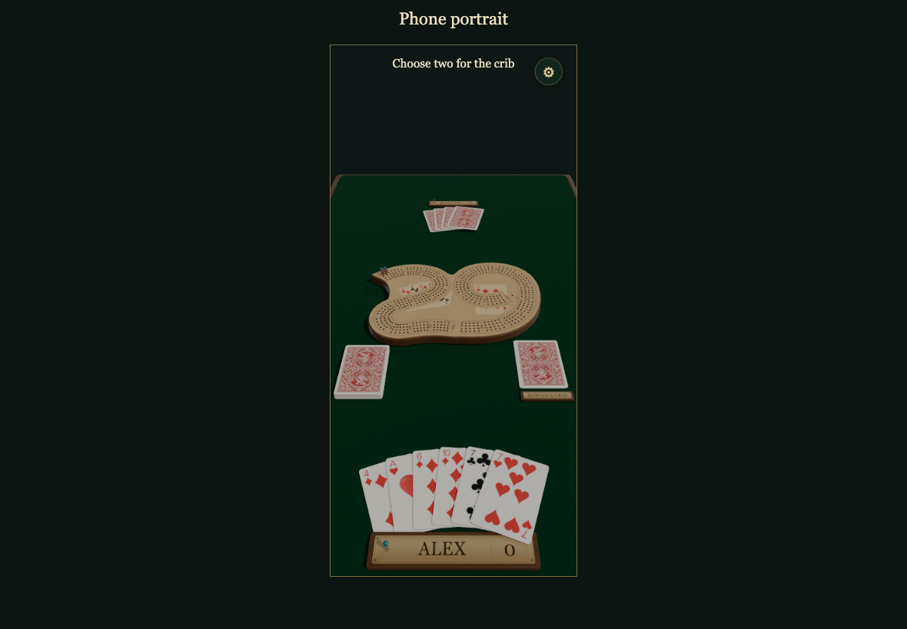
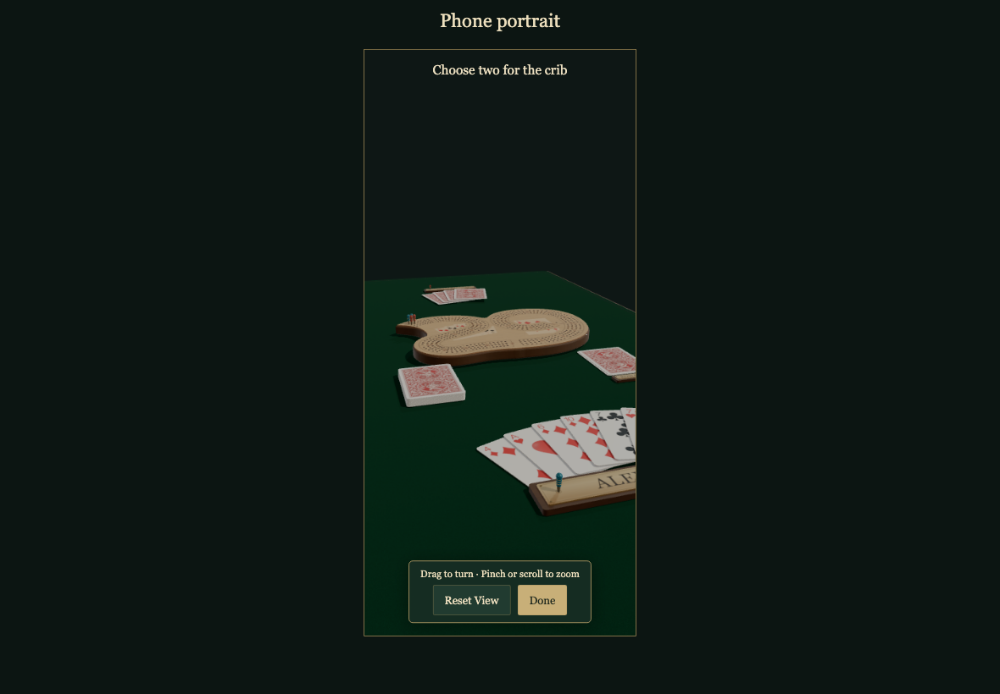
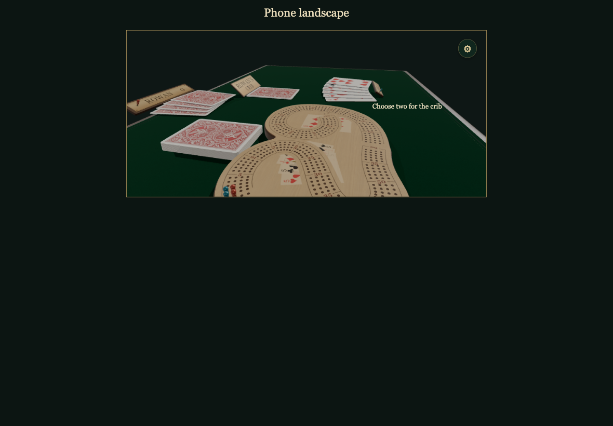
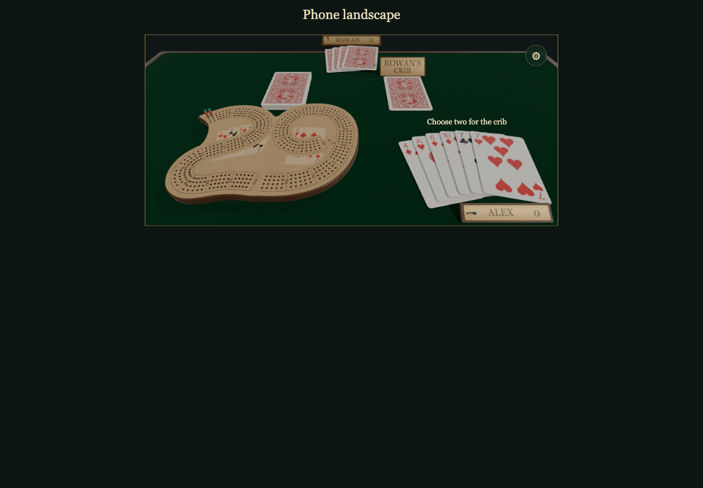
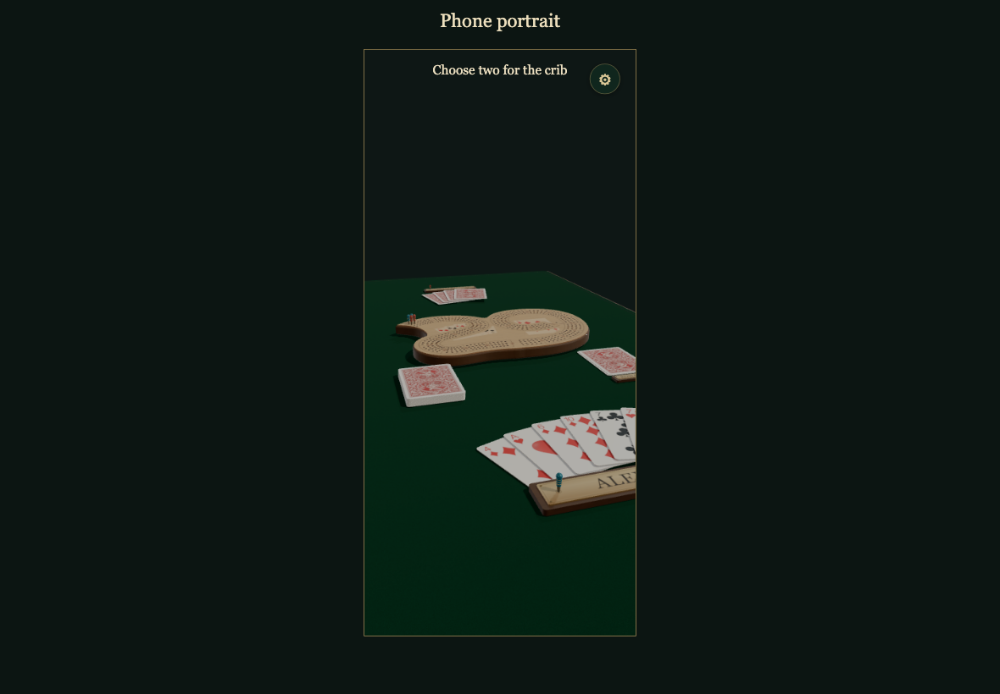

# Personal camera views

The real game runs in a resizable device frame; portrait and landscape poses stay independent. All captures are 1180×820 at 1×; verification allows zero different pixels.

## Normal play keeps the portrait camera locked

Viewpoint: **Alex**

- [x] Dragging does not move the camera or discard a card

## Set Camera turns the table without playing cards

Viewpoint: **Alex**

- [x] Card choices are disabled while camera controls are unlocked

## Landscape has its own saved view

Viewpoint: **Alex**

- [x] Setting landscape leaves the portrait pose intact

## Repeated rotation restores the same landscape view

Viewpoint: **Alex**

- [x] No camera scale or target drift after three portrait/landscape cycles

## Reset View restores only landscape

Viewpoint: **Alex**

- [x] The reviewed default landscape camera returns

## Returning restores portrait and locks the controls

Viewpoint: **Alex**

- [x] Saved camera survives reload, reset in another orientation, and normal play resumes
