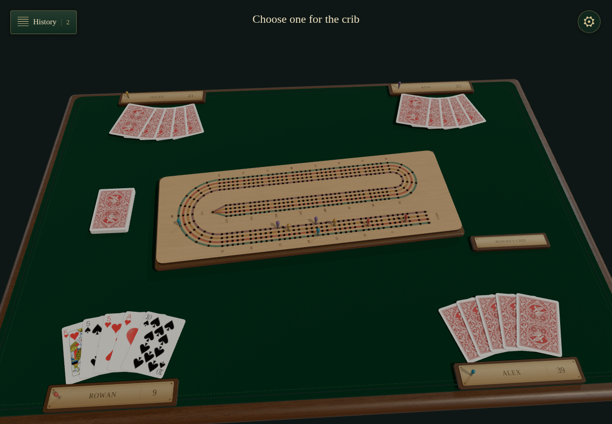
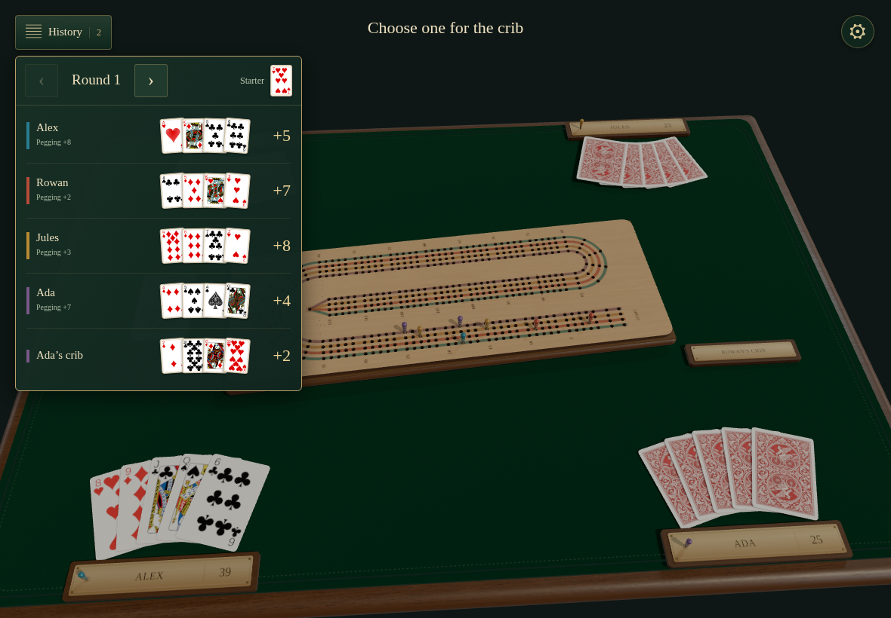
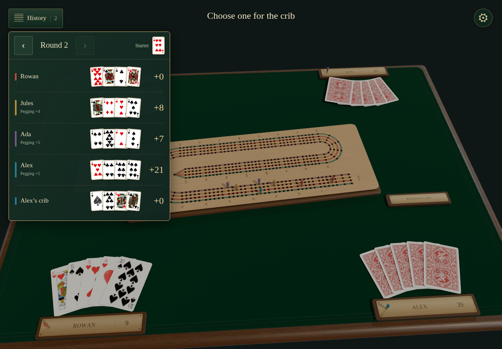
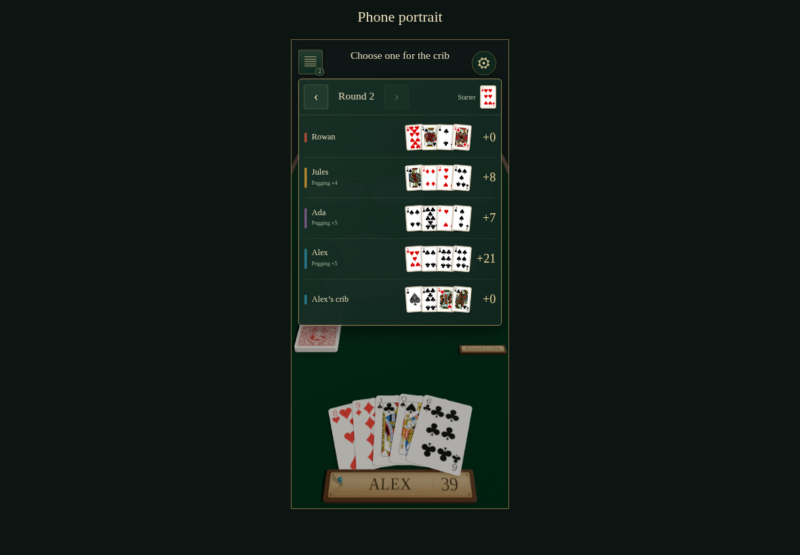
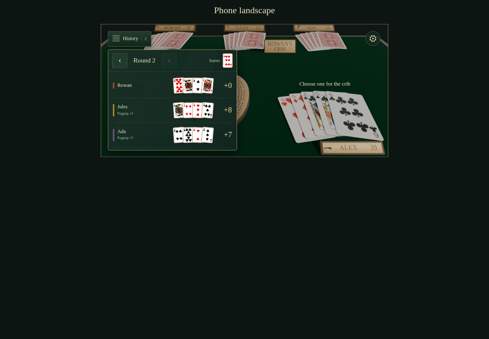
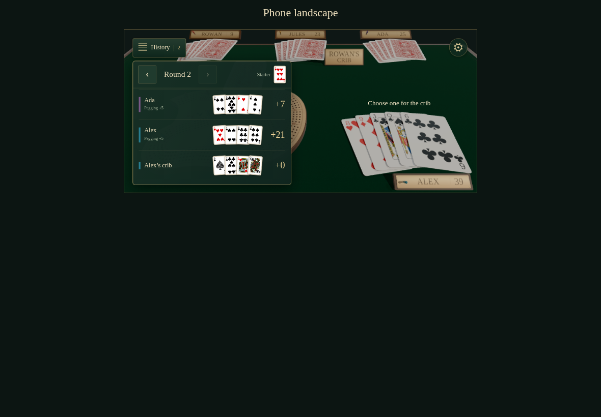

# Reviewing counted hands

Completed public hands and cribs are reviewed independently from every seat, including phone layouts. All captures are 1180×820 at 1×; verification allows zero different pixels.

## Alex opens the latest completed round · actor

Viewpoint: **Alex**

- [x] History is personal; the current deal, revision and concealed opponent cards stay intact

## Alex opens the latest completed round · observer

Viewpoint: **Rowan**

- [x] History is personal; the current deal, revision and concealed opponent cards stay intact

## Alex opens the latest completed round · observer

Viewpoint: **Jules**

- [x] History is personal; the current deal, revision and concealed opponent cards stay intact

## Alex opens the latest completed round · observer

Viewpoint: **Ada**

- [x] History is personal; the current deal, revision and concealed opponent cards stay intact

## Alex reviews the earlier hands and crib · actor

Viewpoint: **Alex**

- [x] History is personal; the current deal, revision and concealed opponent cards stay intact

## Alex reviews the earlier hands and crib · observer

Viewpoint: **Rowan**

- [x] History is personal; the current deal, revision and concealed opponent cards stay intact

## Alex reviews the earlier hands and crib · observer

Viewpoint: **Jules**

- [x] History is personal; the current deal, revision and concealed opponent cards stay intact

## Alex reviews the earlier hands and crib · observer

Viewpoint: **Ada**

- [x] History is personal; the current deal, revision and concealed opponent cards stay intact

## Rowan reviews the latest round independently · actor

Viewpoint: **Rowan**

- [x] History is personal; the current deal, revision and concealed opponent cards stay intact

## Rowan reviews the latest round independently · observer

Viewpoint: **Alex**

- [x] History is personal; the current deal, revision and concealed opponent cards stay intact

## Rowan reviews the latest round independently · observer

Viewpoint: **Jules**

- [x] History is personal; the current deal, revision and concealed opponent cards stay intact

## Rowan reviews the latest round independently · observer

Viewpoint: **Ada**

- [x] History is personal; the current deal, revision and concealed opponent cards stay intact

## Alex returns to the latest counted round · actor

Viewpoint: **Alex**

- [x] History is personal; the current deal, revision and concealed opponent cards stay intact

## Alex returns to the latest counted round · observer

Viewpoint: **Rowan**

- [x] History is personal; the current deal, revision and concealed opponent cards stay intact

## Alex returns to the latest counted round · observer

Viewpoint: **Jules**

- [x] History is personal; the current deal, revision and concealed opponent cards stay intact

## Alex returns to the latest counted round · observer

Viewpoint: **Ada**

- [x] History is personal; the current deal, revision and concealed opponent cards stay intact

## Alex closes history with Escape · actor

Viewpoint: **Alex**

- [x] History is personal; the current deal, revision and concealed opponent cards stay intact

## Alex closes history with Escape · observer

Viewpoint: **Rowan**

- [x] History is personal; the current deal, revision and concealed opponent cards stay intact

## Alex closes history with Escape · observer

Viewpoint: **Jules**

- [x] History is personal; the current deal, revision and concealed opponent cards stay intact

## Alex closes history with Escape · observer

Viewpoint: **Ada**

- [x] History is personal; the current deal, revision and concealed opponent cards stay intact

## Returning restores history from the same intent log · actor

Viewpoint: **Alex**

- [x] History is personal; the current deal, revision and concealed opponent cards stay intact

## Returning restores history from the same intent log · observer

Viewpoint: **Rowan**

- [x] History is personal; the current deal, revision and concealed opponent cards stay intact

## Returning restores history from the same intent log · observer

Viewpoint: **Jules**

- [x] History is personal; the current deal, revision and concealed opponent cards stay intact

## Returning restores history from the same intent log · observer

Viewpoint: **Ada**

- [x] History is personal; the current deal, revision and concealed opponent cards stay intact

## Review the four hands and crib on phone portrait

Viewpoint: **Alex**

- [x] The panel stays inside the device and its card list scrolls without covering navigation

## Review the four hands and crib on phone landscape

Viewpoint: **Alex**

- [x] The panel stays inside the device and its card list scrolls without covering navigation

## Scroll to the dealer’s crib on phone landscape

Viewpoint: **Alex**

- [x] The last player and crib remain readable below the fixed round navigation
