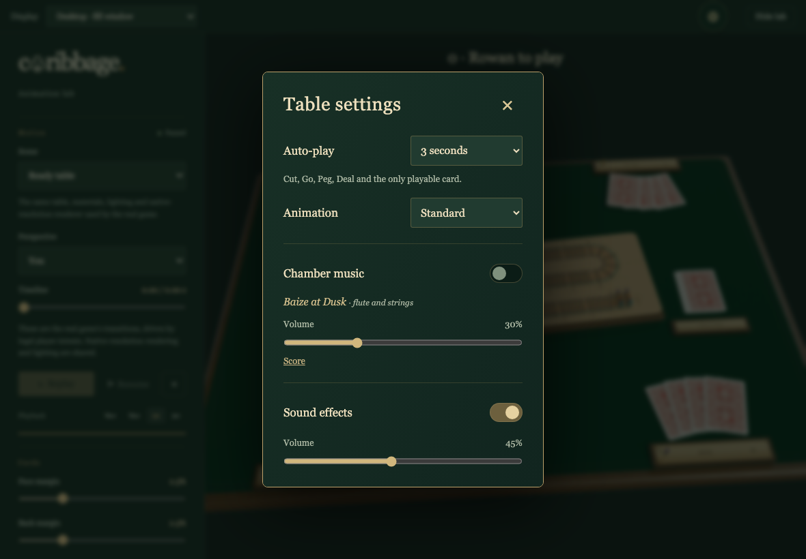
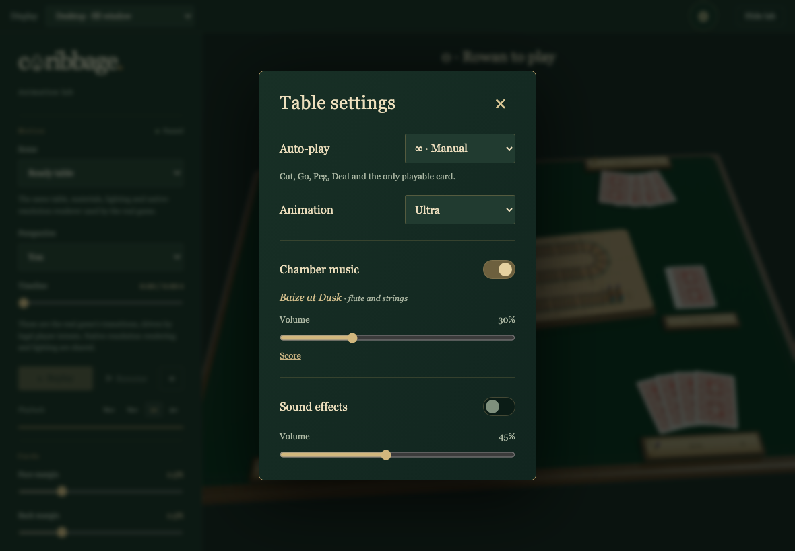
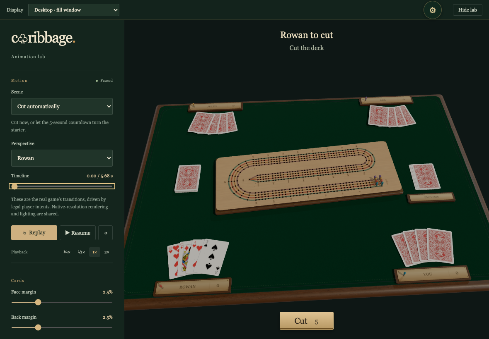
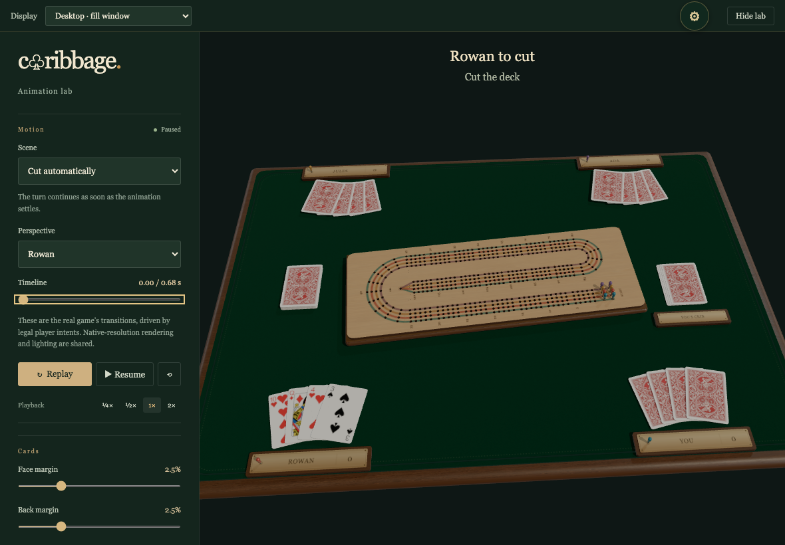
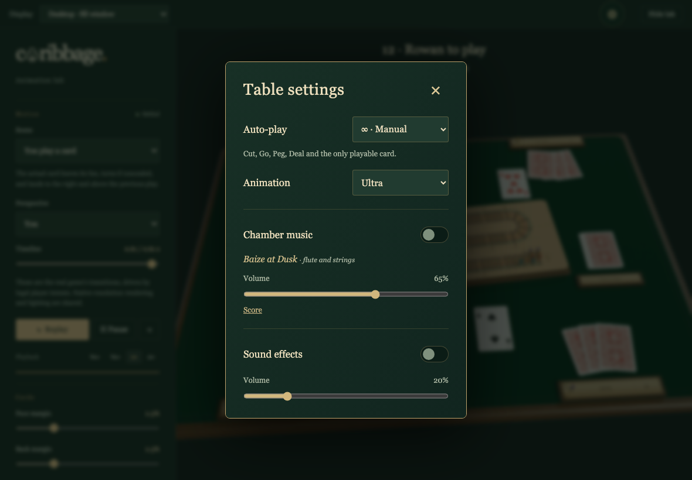

# Personal table settings

Personal settings, audio playback and reload are exercised through the visible controls. All captures are 1180×820 at 1×; verification allows zero different pixels.

## Open the table settings

Viewpoint: **You**

- [x] A named modal with default timing, standard animation, music off and effects on

## Choose Manual, Ultra and the original chamber piece

Viewpoint: **You**

- [x] Actual Web Audio decoding and playback succeed while effects are independently disabled

## Five real seconds before Cut, with faster motion

Viewpoint: **You**

- [x] Animation speed does not shorten the automatic turn countdown

## Continue immediately when no wait is chosen

Viewpoint: **You**

- [x] The legal Cut transition starts immediately and has no countdown to wait through

## Mute both audio channels and keep personal volumes

Viewpoint: **You**

- [x] Music and effects are off, with independent 65% and 20% levels saved

## Return to the saved table settings

Viewpoint: **You**

- [x] Timing, speed, both switches and both volumes survive a page reload
