# Four friends at the cribbage table

Every user action is followed by the actor's view and all seated observers. All captures are 1180×820 at 1×; verification allows zero different pixels.

## Alex opens the table · actor

Viewpoint: **Alex**

- [x] Exact phase, revision, round, count, crib size, clockwise seats, scores, private hands, public plays and legal native-card controls

## Rowan takes a chair · actor

Viewpoint: **Rowan**

- [x] Exact phase, revision, round, count, crib size, clockwise seats, scores, private hands, public plays and legal native-card controls

## Rowan takes a chair · observer

Viewpoint: **Alex**

- [x] Exact phase, revision, round, count, crib size, clockwise seats, scores, private hands, public plays and legal native-card controls

## Jules takes a chair · actor

Viewpoint: **Jules**

- [x] Exact phase, revision, round, count, crib size, clockwise seats, scores, private hands, public plays and legal native-card controls

## Jules takes a chair · observer

Viewpoint: **Alex**

- [x] Exact phase, revision, round, count, crib size, clockwise seats, scores, private hands, public plays and legal native-card controls

## Jules takes a chair · observer

Viewpoint: **Rowan**

- [x] Exact phase, revision, round, count, crib size, clockwise seats, scores, private hands, public plays and legal native-card controls

## Ada takes a chair · actor

Viewpoint: **Ada**

- [x] Exact phase, revision, round, count, crib size, clockwise seats, scores, private hands, public plays and legal native-card controls

## Ada takes a chair · observer

Viewpoint: **Alex**

- [x] Exact phase, revision, round, count, crib size, clockwise seats, scores, private hands, public plays and legal native-card controls

## Ada takes a chair · observer

Viewpoint: **Rowan**

- [x] Exact phase, revision, round, count, crib size, clockwise seats, scores, private hands, public plays and legal native-card controls

## Ada takes a chair · observer

Viewpoint: **Jules**

- [x] Exact phase, revision, round, count, crib size, clockwise seats, scores, private hands, public plays and legal native-card controls

## Alex deals five cards to everyone · actor

Viewpoint: **Alex**

- [x] Exact phase, revision, round, count, crib size, clockwise seats, scores, private hands, public plays and legal native-card controls

## Alex deals five cards to everyone · observer

Viewpoint: **Rowan**

- [x] Exact phase, revision, round, count, crib size, clockwise seats, scores, private hands, public plays and legal native-card controls

## Alex deals five cards to everyone · observer

Viewpoint: **Jules**

- [x] Exact phase, revision, round, count, crib size, clockwise seats, scores, private hands, public plays and legal native-card controls

## Alex deals five cards to everyone · observer

Viewpoint: **Ada**

- [x] Exact phase, revision, round, count, crib size, clockwise seats, scores, private hands, public plays and legal native-card controls

## Alex puts 10 of diamonds in the crib · actor

Viewpoint: **Alex**

- [x] Exact phase, revision, round, count, crib size, clockwise seats, scores, private hands, public plays and legal native-card controls

## Alex puts 10 of diamonds in the crib · observer

Viewpoint: **Rowan**

- [x] Exact phase, revision, round, count, crib size, clockwise seats, scores, private hands, public plays and legal native-card controls

## Alex puts 10 of diamonds in the crib · observer

Viewpoint: **Jules**

- [x] Exact phase, revision, round, count, crib size, clockwise seats, scores, private hands, public plays and legal native-card controls

## Alex puts 10 of diamonds in the crib · observer

Viewpoint: **Ada**

- [x] Exact phase, revision, round, count, crib size, clockwise seats, scores, private hands, public plays and legal native-card controls

## Rowan puts 2 of diamonds in the crib · actor

Viewpoint: **Rowan**

- [x] Exact phase, revision, round, count, crib size, clockwise seats, scores, private hands, public plays and legal native-card controls

## Rowan puts 2 of diamonds in the crib · observer

Viewpoint: **Alex**

- [x] Exact phase, revision, round, count, crib size, clockwise seats, scores, private hands, public plays and legal native-card controls

## Rowan puts 2 of diamonds in the crib · observer

Viewpoint: **Jules**

- [x] Exact phase, revision, round, count, crib size, clockwise seats, scores, private hands, public plays and legal native-card controls

## Rowan puts 2 of diamonds in the crib · observer

Viewpoint: **Ada**

- [x] Exact phase, revision, round, count, crib size, clockwise seats, scores, private hands, public plays and legal native-card controls

## Jules puts 3 of spades in the crib · actor

Viewpoint: **Jules**

- [x] Exact phase, revision, round, count, crib size, clockwise seats, scores, private hands, public plays and legal native-card controls

## Jules puts 3 of spades in the crib · observer

Viewpoint: **Alex**

- [x] Exact phase, revision, round, count, crib size, clockwise seats, scores, private hands, public plays and legal native-card controls

## Jules puts 3 of spades in the crib · observer

Viewpoint: **Rowan**

- [x] Exact phase, revision, round, count, crib size, clockwise seats, scores, private hands, public plays and legal native-card controls

## Jules puts 3 of spades in the crib · observer

Viewpoint: **Ada**

- [x] Exact phase, revision, round, count, crib size, clockwise seats, scores, private hands, public plays and legal native-card controls

## Ada puts King of diamonds in the crib · actor

Viewpoint: **Ada**

- [x] Exact phase, revision, round, count, crib size, clockwise seats, scores, private hands, public plays and legal native-card controls

## Ada puts King of diamonds in the crib · observer

Viewpoint: **Alex**

- [x] Exact phase, revision, round, count, crib size, clockwise seats, scores, private hands, public plays and legal native-card controls

## Ada puts King of diamonds in the crib · observer

Viewpoint: **Rowan**

- [x] Exact phase, revision, round, count, crib size, clockwise seats, scores, private hands, public plays and legal native-card controls

## Ada puts King of diamonds in the crib · observer

Viewpoint: **Jules**

- [x] Exact phase, revision, round, count, crib size, clockwise seats, scores, private hands, public plays and legal native-card controls

## Alex · the crib is ready · actor

Viewpoint: **Alex**

- [x] Exact phase, revision, round, count, crib size, clockwise seats, scores, private hands, public plays and legal native-card controls

## Alex · the crib is ready · observer

Viewpoint: **Rowan**

- [x] Exact phase, revision, round, count, crib size, clockwise seats, scores, private hands, public plays and legal native-card controls

## Alex · the crib is ready · observer

Viewpoint: **Jules**

- [x] Exact phase, revision, round, count, crib size, clockwise seats, scores, private hands, public plays and legal native-card controls

## Alex · the crib is ready · observer

Viewpoint: **Ada**

- [x] Exact phase, revision, round, count, crib size, clockwise seats, scores, private hands, public plays and legal native-card controls

## Alex · cut automatically · actor

Viewpoint: **Alex**

- [x] Exact phase, revision, round, count, crib size, clockwise seats, scores, private hands, public plays and legal native-card controls

## Alex · cut automatically · observer

Viewpoint: **Rowan**

- [x] Exact phase, revision, round, count, crib size, clockwise seats, scores, private hands, public plays and legal native-card controls

## Alex · cut automatically · observer

Viewpoint: **Jules**

- [x] Exact phase, revision, round, count, crib size, clockwise seats, scores, private hands, public plays and legal native-card controls

## Alex · cut automatically · observer

Viewpoint: **Ada**

- [x] Exact phase, revision, round, count, crib size, clockwise seats, scores, private hands, public plays and legal native-card controls

## Alex plays 2 of hearts · actor

Viewpoint: **Alex**

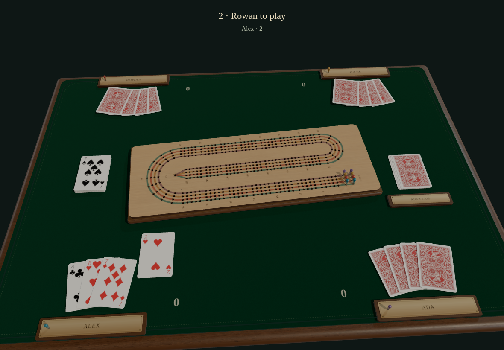

- [x] Exact phase, revision, round, count, crib size, clockwise seats, scores, private hands, public plays and legal native-card controls

## Alex plays 2 of hearts · observer

Viewpoint: **Rowan**

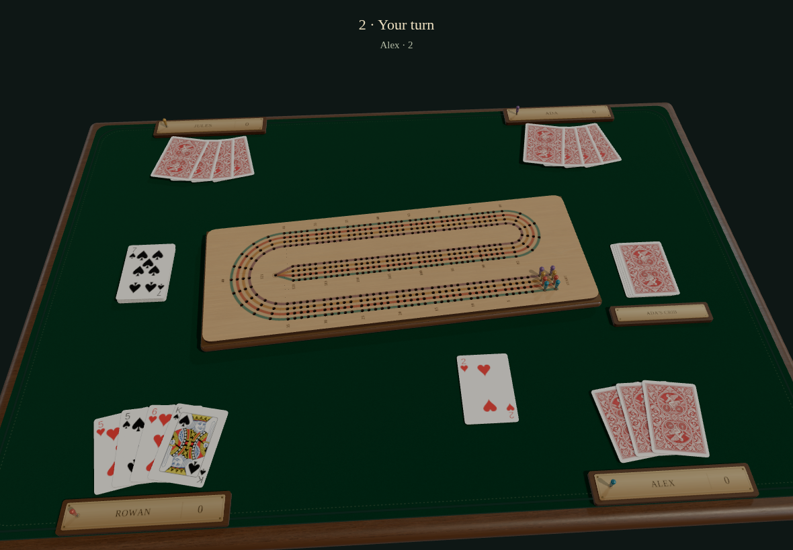

- [x] Exact phase, revision, round, count, crib size, clockwise seats, scores, private hands, public plays and legal native-card controls

## Alex plays 2 of hearts · observer

Viewpoint: **Jules**

- [x] Exact phase, revision, round, count, crib size, clockwise seats, scores, private hands, public plays and legal native-card controls

## Alex plays 2 of hearts · observer

Viewpoint: **Ada**

- [x] Exact phase, revision, round, count, crib size, clockwise seats, scores, private hands, public plays and legal native-card controls

## Rowan plays 5 of hearts · actor

Viewpoint: **Rowan**

- [x] Exact phase, revision, round, count, crib size, clockwise seats, scores, private hands, public plays and legal native-card controls

## Rowan plays 5 of hearts · observer

Viewpoint: **Alex**

- [x] Exact phase, revision, round, count, crib size, clockwise seats, scores, private hands, public plays and legal native-card controls

## Rowan plays 5 of hearts · observer

Viewpoint: **Jules**

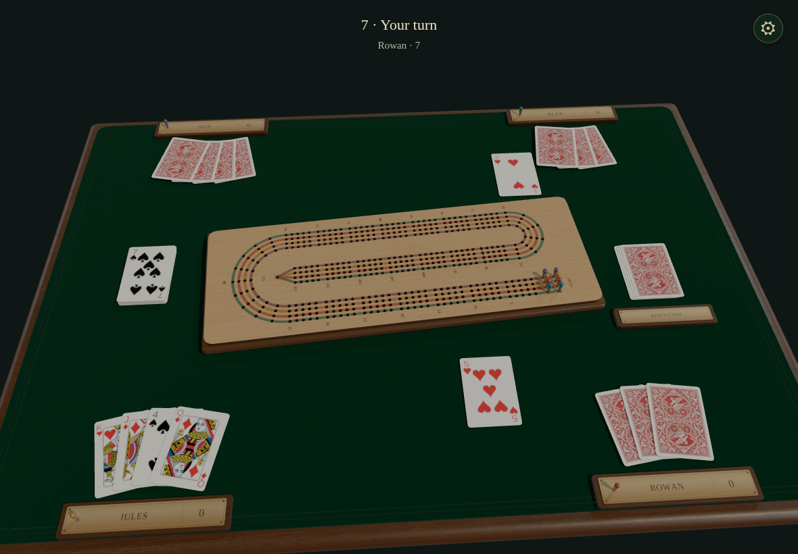

- [x] Exact phase, revision, round, count, crib size, clockwise seats, scores, private hands, public plays and legal native-card controls

## Rowan plays 5 of hearts · observer

Viewpoint: **Ada**

- [x] Exact phase, revision, round, count, crib size, clockwise seats, scores, private hands, public plays and legal native-card controls

## Jules plays 4 of spades · actor

Viewpoint: **Jules**

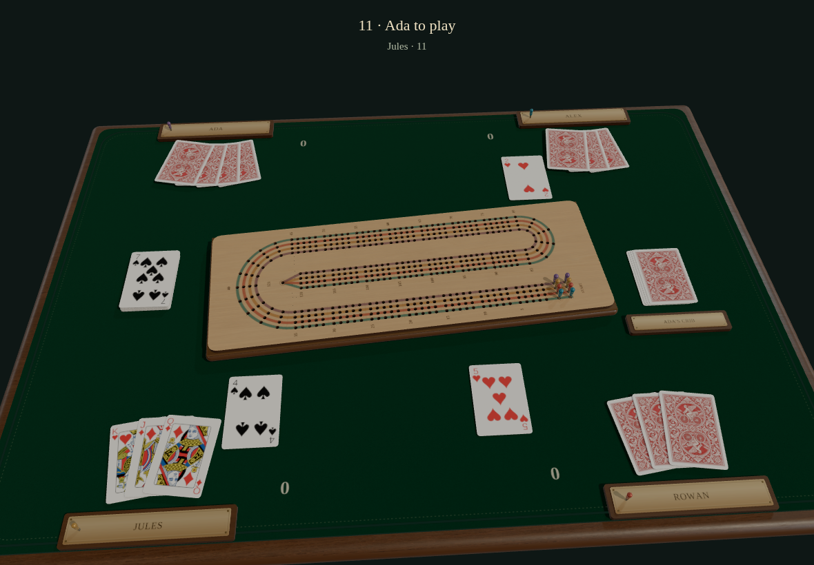

- [x] Exact phase, revision, round, count, crib size, clockwise seats, scores, private hands, public plays and legal native-card controls

## Jules plays 4 of spades · observer

Viewpoint: **Alex**

- [x] Exact phase, revision, round, count, crib size, clockwise seats, scores, private hands, public plays and legal native-card controls

## Jules plays 4 of spades · observer

Viewpoint: **Rowan**

- [x] Exact phase, revision, round, count, crib size, clockwise seats, scores, private hands, public plays and legal native-card controls

## Jules plays 4 of spades · observer

Viewpoint: **Ada**

- [x] Exact phase, revision, round, count, crib size, clockwise seats, scores, private hands, public plays and legal native-card controls

## Ada plays 3 of clubs · actor

Viewpoint: **Ada**

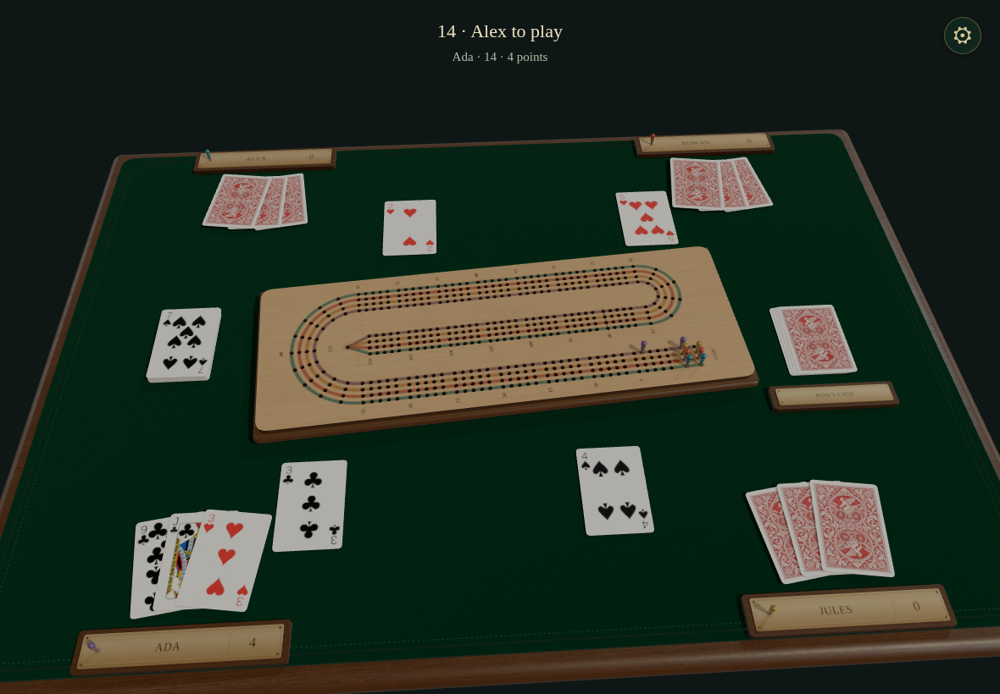

- [x] Exact phase, revision, round, count, crib size, clockwise seats, scores, private hands, public plays and legal native-card controls

## Ada plays 3 of clubs · observer

Viewpoint: **Alex**

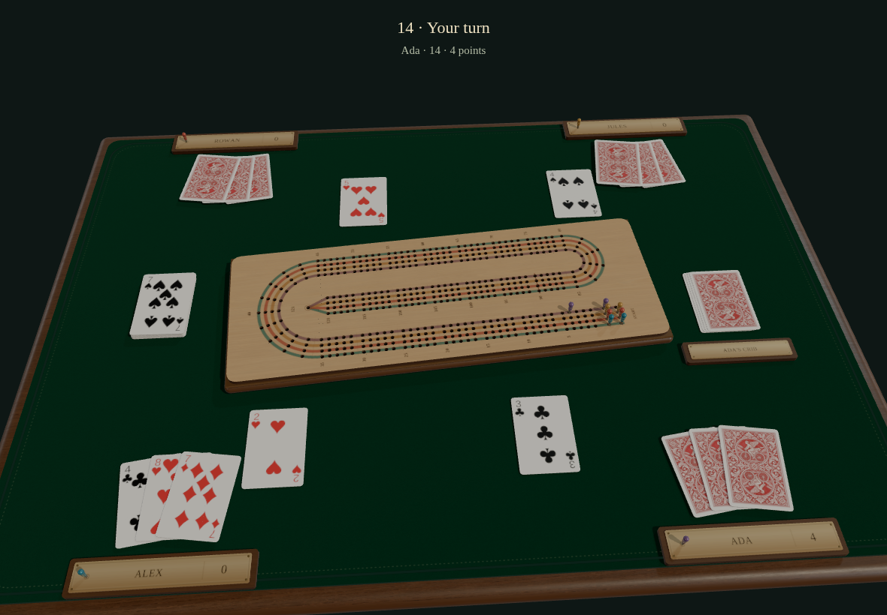

- [x] Exact phase, revision, round, count, crib size, clockwise seats, scores, private hands, public plays and legal native-card controls

## Ada plays 3 of clubs · observer

Viewpoint: **Rowan**

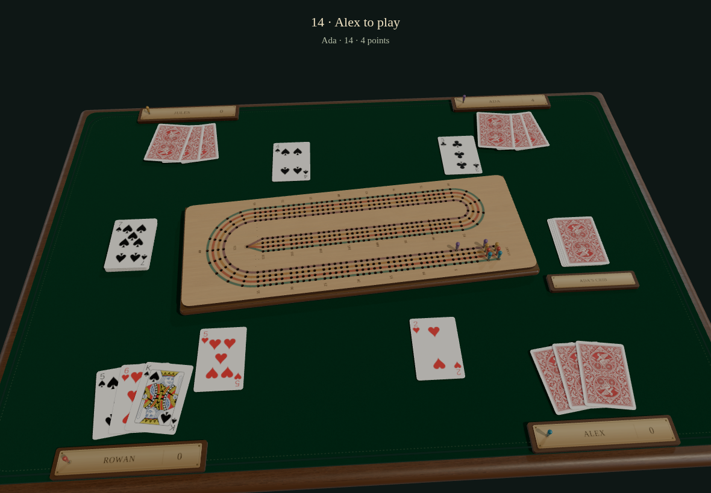

- [x] Exact phase, revision, round, count, crib size, clockwise seats, scores, private hands, public plays and legal native-card controls

## Ada plays 3 of clubs · observer

Viewpoint: **Jules**

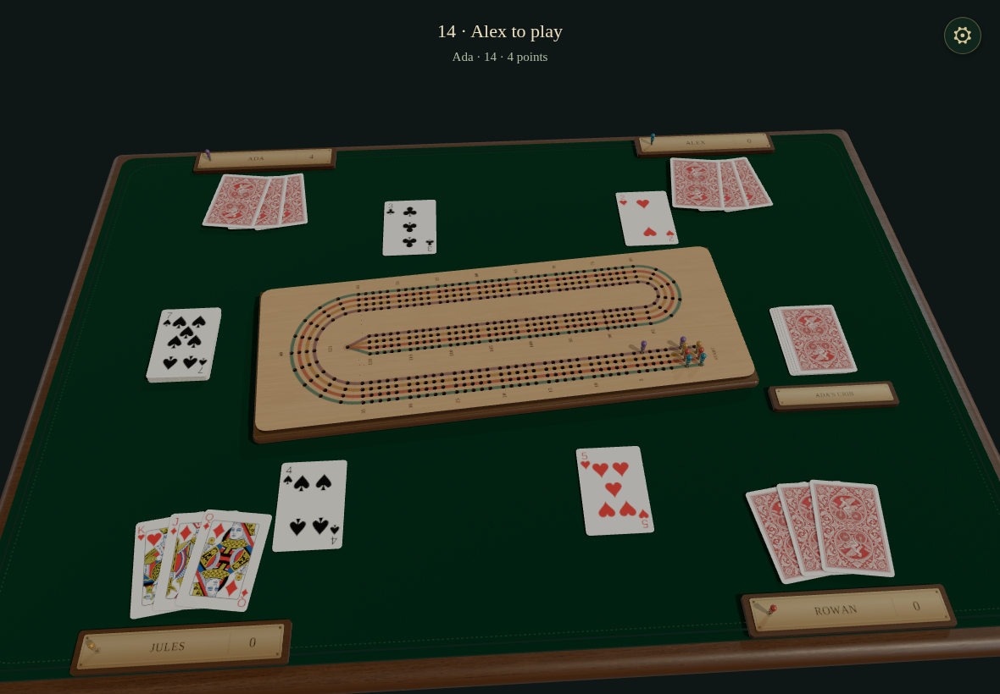

- [x] Exact phase, revision, round, count, crib size, clockwise seats, scores, private hands, public plays and legal native-card controls

## Alex plays 4 of clubs · actor

Viewpoint: **Alex**

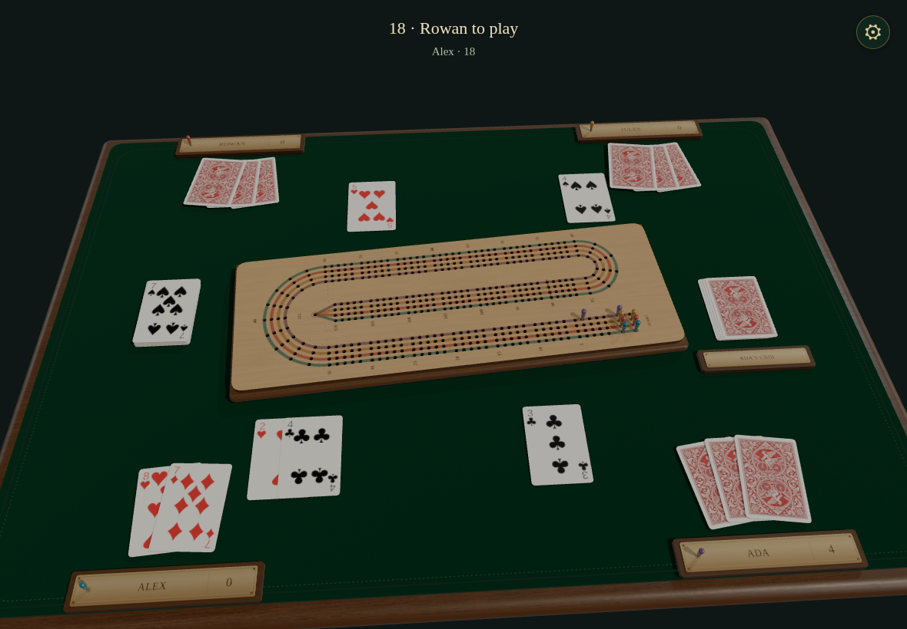

- [x] Exact phase, revision, round, count, crib size, clockwise seats, scores, private hands, public plays and legal native-card controls

## Alex plays 4 of clubs · observer

Viewpoint: **Rowan**

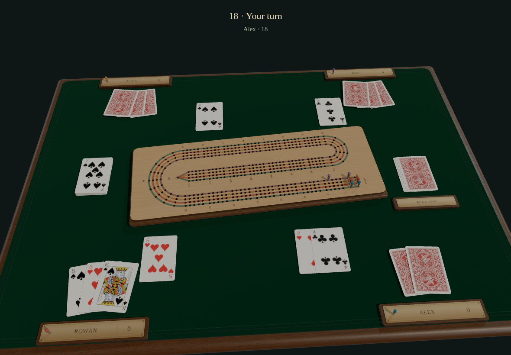

- [x] Exact phase, revision, round, count, crib size, clockwise seats, scores, private hands, public plays and legal native-card controls

## Alex plays 4 of clubs · observer

Viewpoint: **Jules**

- [x] Exact phase, revision, round, count, crib size, clockwise seats, scores, private hands, public plays and legal native-card controls

## Alex plays 4 of clubs · observer

Viewpoint: **Ada**

- [x] Exact phase, revision, round, count, crib size, clockwise seats, scores, private hands, public plays and legal native-card controls

## Rowan plays 5 of spades · actor

Viewpoint: **Rowan**

- [x] Exact phase, revision, round, count, crib size, clockwise seats, scores, private hands, public plays and legal native-card controls

## Rowan plays 5 of spades · observer

Viewpoint: **Alex**

- [x] Exact phase, revision, round, count, crib size, clockwise seats, scores, private hands, public plays and legal native-card controls

## Rowan plays 5 of spades · observer

Viewpoint: **Jules**

- [x] Exact phase, revision, round, count, crib size, clockwise seats, scores, private hands, public plays and legal native-card controls

## Rowan plays 5 of spades · observer

Viewpoint: **Ada**

- [x] Exact phase, revision, round, count, crib size, clockwise seats, scores, private hands, public plays and legal native-card controls

## Go will play automatically in one second · actor

Viewpoint: **Jules**

- [x] Exact phase, revision, round, count, crib size, clockwise seats, scores, private hands, public plays and legal native-card controls

## Go will play automatically in one second · observer

Viewpoint: **Alex**

- [x] Exact phase, revision, round, count, crib size, clockwise seats, scores, private hands, public plays and legal native-card controls

## Go will play automatically in one second · observer

Viewpoint: **Rowan**

- [x] Exact phase, revision, round, count, crib size, clockwise seats, scores, private hands, public plays and legal native-card controls

## Go will play automatically in one second · observer

Viewpoint: **Ada**

- [x] Exact phase, revision, round, count, crib size, clockwise seats, scores, private hands, public plays and legal native-card controls

## Jules · go automatically · actor

Viewpoint: **Jules**

- [x] Exact phase, revision, round, count, crib size, clockwise seats, scores, private hands, public plays and legal native-card controls

## Jules · go automatically · observer

Viewpoint: **Alex**

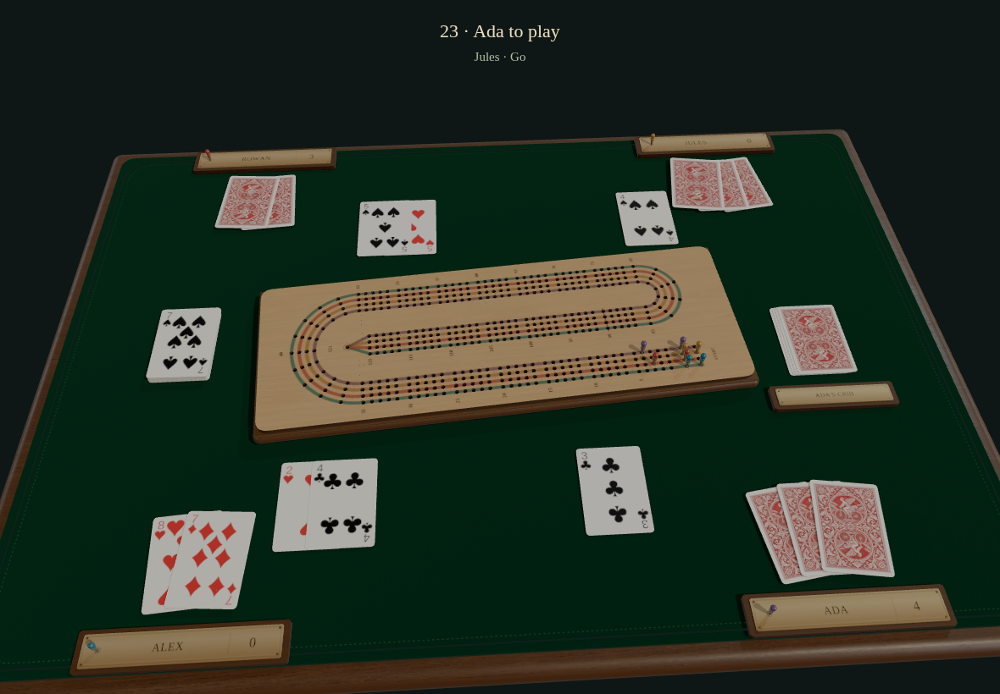

- [x] Exact phase, revision, round, count, crib size, clockwise seats, scores, private hands, public plays and legal native-card controls

## Jules · go automatically · observer

Viewpoint: **Rowan**

- [x] Exact phase, revision, round, count, crib size, clockwise seats, scores, private hands, public plays and legal native-card controls

## Jules · go automatically · observer

Viewpoint: **Ada**

- [x] Exact phase, revision, round, count, crib size, clockwise seats, scores, private hands, public plays and legal native-card controls

## Ada · plays 3 of hearts automatically · actor

Viewpoint: **Ada**

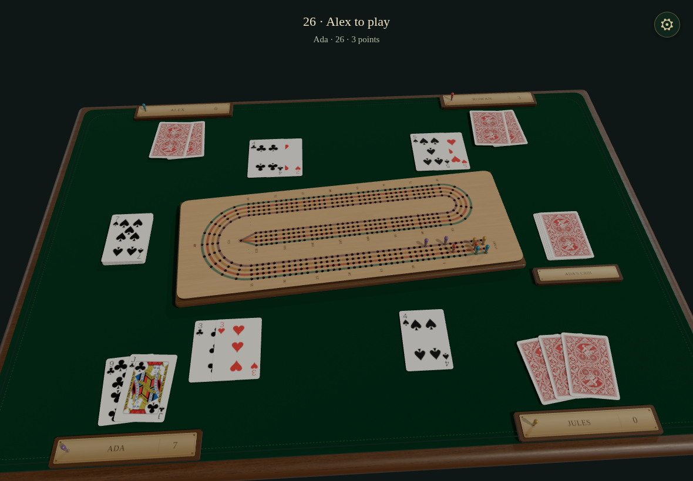

- [x] Exact phase, revision, round, count, crib size, clockwise seats, scores, private hands, public plays and legal native-card controls

## Ada · plays 3 of hearts automatically · observer

Viewpoint: **Alex**

- [x] Exact phase, revision, round, count, crib size, clockwise seats, scores, private hands, public plays and legal native-card controls

## Ada · plays 3 of hearts automatically · observer

Viewpoint: **Rowan**

- [x] Exact phase, revision, round, count, crib size, clockwise seats, scores, private hands, public plays and legal native-card controls

## Ada · plays 3 of hearts automatically · observer

Viewpoint: **Jules**

- [x] Exact phase, revision, round, count, crib size, clockwise seats, scores, private hands, public plays and legal native-card controls

## Alex · go automatically · actor

Viewpoint: **Alex**

- [x] Exact phase, revision, round, count, crib size, clockwise seats, scores, private hands, public plays and legal native-card controls

## Alex · go automatically · observer

Viewpoint: **Rowan**

- [x] Exact phase, revision, round, count, crib size, clockwise seats, scores, private hands, public plays and legal native-card controls

## Alex · go automatically · observer

Viewpoint: **Jules**

- [x] Exact phase, revision, round, count, crib size, clockwise seats, scores, private hands, public plays and legal native-card controls

## Alex · go automatically · observer

Viewpoint: **Ada**

- [x] Exact phase, revision, round, count, crib size, clockwise seats, scores, private hands, public plays and legal native-card controls

## Rowan · go automatically · actor

Viewpoint: **Rowan**

- [x] Exact phase, revision, round, count, crib size, clockwise seats, scores, private hands, public plays and legal native-card controls

## Rowan · go automatically · observer

Viewpoint: **Alex**

- [x] Exact phase, revision, round, count, crib size, clockwise seats, scores, private hands, public plays and legal native-card controls

## Rowan · go automatically · observer

Viewpoint: **Jules**

- [x] Exact phase, revision, round, count, crib size, clockwise seats, scores, private hands, public plays and legal native-card controls

## Rowan · go automatically · observer

Viewpoint: **Ada**

- [x] Exact phase, revision, round, count, crib size, clockwise seats, scores, private hands, public plays and legal native-card controls

## Ada · go automatically · actor

Viewpoint: **Ada**

- [x] Exact phase, revision, round, count, crib size, clockwise seats, scores, private hands, public plays and legal native-card controls

## Ada · go automatically · observer

Viewpoint: **Alex**

- [x] Exact phase, revision, round, count, crib size, clockwise seats, scores, private hands, public plays and legal native-card controls

## Ada · go automatically · observer

Viewpoint: **Rowan**

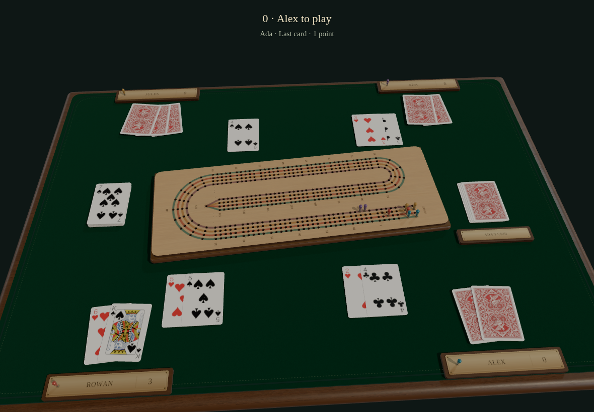

- [x] Exact phase, revision, round, count, crib size, clockwise seats, scores, private hands, public plays and legal native-card controls

## Ada · go automatically · observer

Viewpoint: **Jules**

- [x] Exact phase, revision, round, count, crib size, clockwise seats, scores, private hands, public plays and legal native-card controls

## Alex plays 7 of diamonds · actor

Viewpoint: **Alex**

- [x] Exact phase, revision, round, count, crib size, clockwise seats, scores, private hands, public plays and legal native-card controls

## Alex plays 7 of diamonds · observer

Viewpoint: **Rowan**

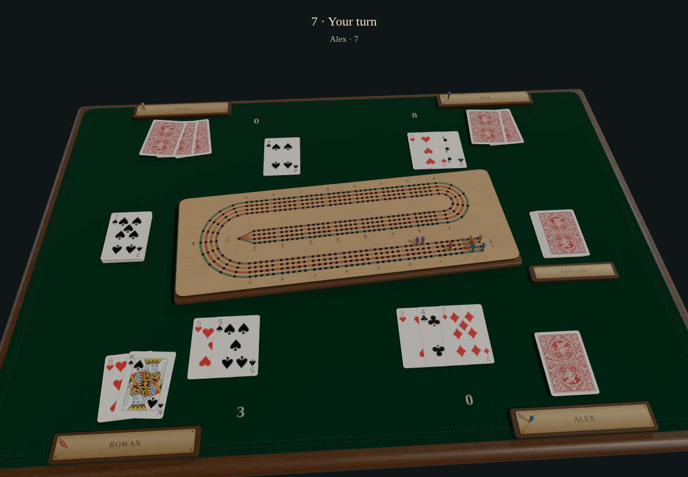

- [x] Exact phase, revision, round, count, crib size, clockwise seats, scores, private hands, public plays and legal native-card controls

## Alex plays 7 of diamonds · observer

Viewpoint: **Jules**

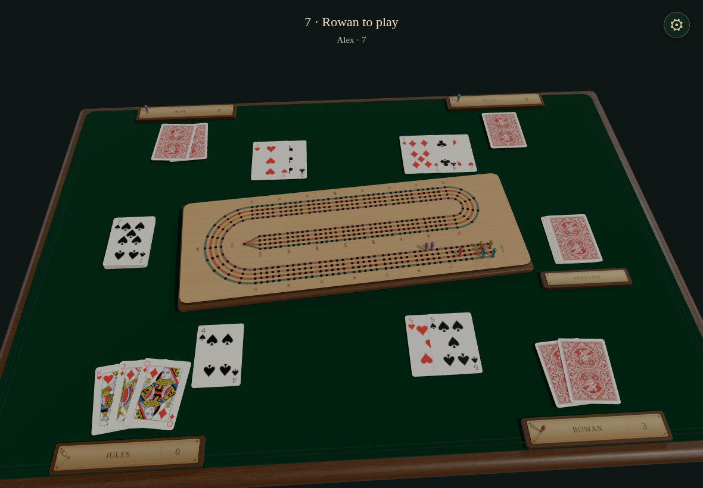

- [x] Exact phase, revision, round, count, crib size, clockwise seats, scores, private hands, public plays and legal native-card controls

## Alex plays 7 of diamonds · observer

Viewpoint: **Ada**

- [x] Exact phase, revision, round, count, crib size, clockwise seats, scores, private hands, public plays and legal native-card controls

## Rowan plays 6 of hearts · actor

Viewpoint: **Rowan**

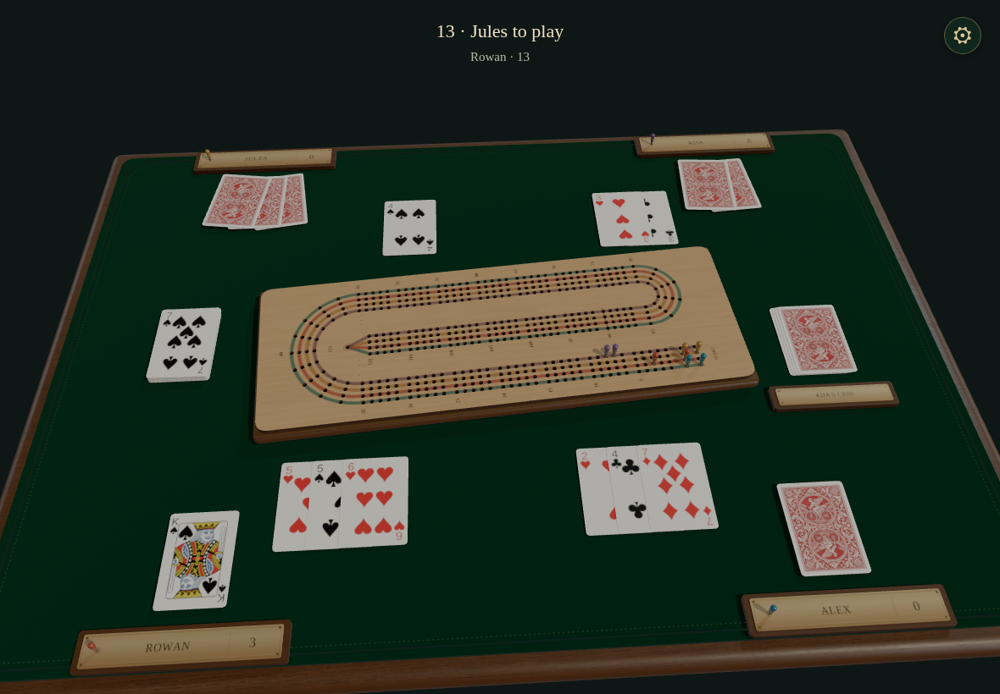

- [x] Exact phase, revision, round, count, crib size, clockwise seats, scores, private hands, public plays and legal native-card controls

## Rowan plays 6 of hearts · observer

Viewpoint: **Alex**

- [x] Exact phase, revision, round, count, crib size, clockwise seats, scores, private hands, public plays and legal native-card controls

## Rowan plays 6 of hearts · observer

Viewpoint: **Jules**

- [x] Exact phase, revision, round, count, crib size, clockwise seats, scores, private hands, public plays and legal native-card controls

## Rowan plays 6 of hearts · observer

Viewpoint: **Ada**

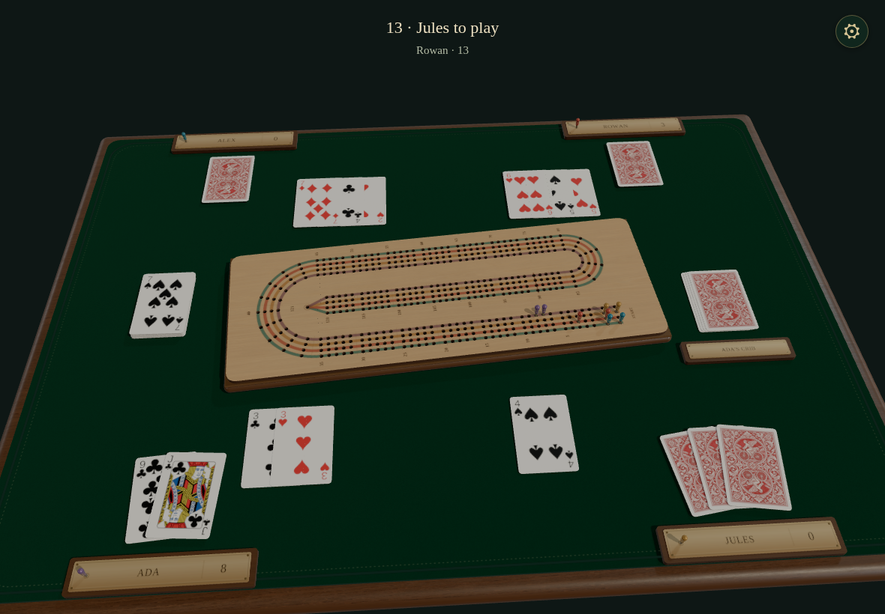

- [x] Exact phase, revision, round, count, crib size, clockwise seats, scores, private hands, public plays and legal native-card controls

## Jules plays Jack of diamonds · actor

Viewpoint: **Jules**

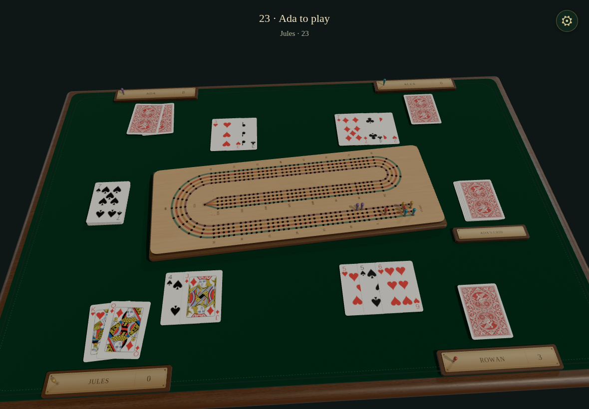

- [x] Exact phase, revision, round, count, crib size, clockwise seats, scores, private hands, public plays and legal native-card controls

## Jules plays Jack of diamonds · observer

Viewpoint: **Alex**

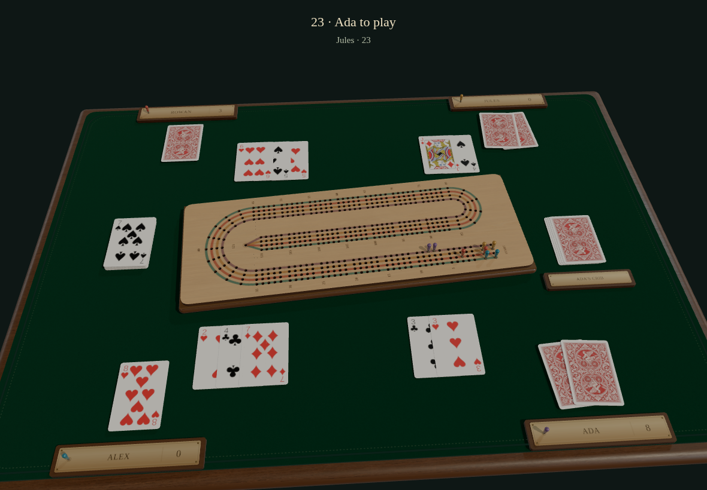

- [x] Exact phase, revision, round, count, crib size, clockwise seats, scores, private hands, public plays and legal native-card controls

## Jules plays Jack of diamonds · observer

Viewpoint: **Rowan**

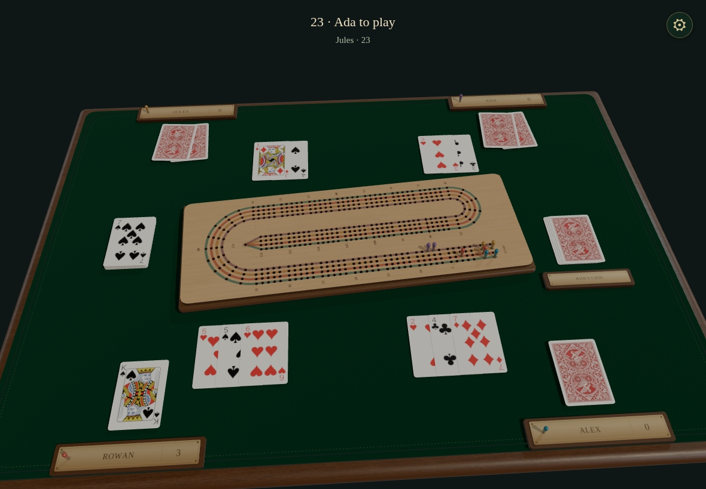

- [x] Exact phase, revision, round, count, crib size, clockwise seats, scores, private hands, public plays and legal native-card controls

## Jules plays Jack of diamonds · observer

Viewpoint: **Ada**

- [x] Exact phase, revision, round, count, crib size, clockwise seats, scores, private hands, public plays and legal native-card controls

## Ada · go automatically · actor

Viewpoint: **Ada**

- [x] Exact phase, revision, round, count, crib size, clockwise seats, scores, private hands, public plays and legal native-card controls

## Ada · go automatically · observer

Viewpoint: **Alex**

- [x] Exact phase, revision, round, count, crib size, clockwise seats, scores, private hands, public plays and legal native-card controls

## Ada · go automatically · observer

Viewpoint: **Rowan**

- [x] Exact phase, revision, round, count, crib size, clockwise seats, scores, private hands, public plays and legal native-card controls

## Ada · go automatically · observer

Viewpoint: **Jules**

- [x] Exact phase, revision, round, count, crib size, clockwise seats, scores, private hands, public plays and legal native-card controls

## Alex · plays 8 of hearts automatically · actor

Viewpoint: **Alex**

- [x] Exact phase, revision, round, count, crib size, clockwise seats, scores, private hands, public plays and legal native-card controls

## Alex · plays 8 of hearts automatically · observer

Viewpoint: **Rowan**

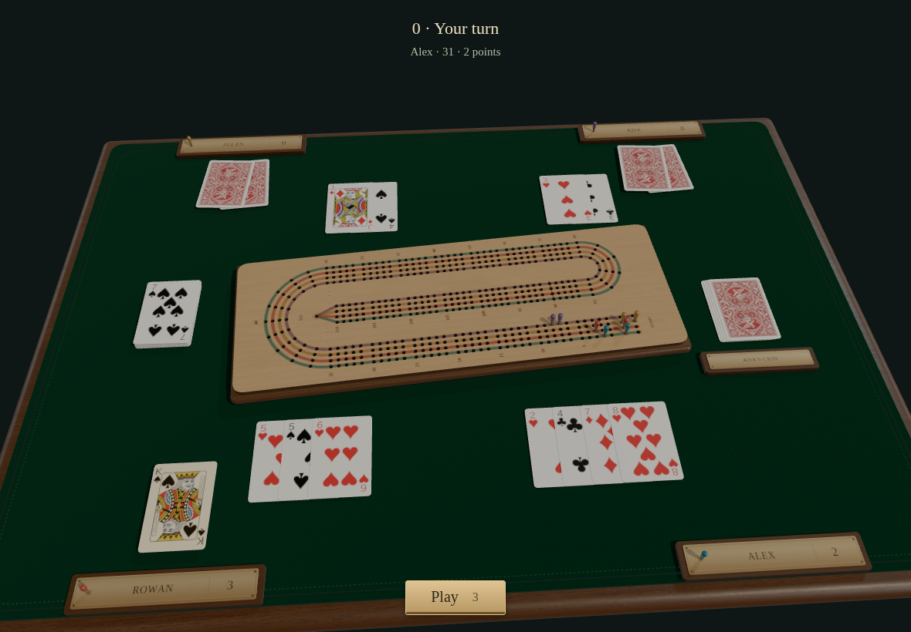

- [x] Exact phase, revision, round, count, crib size, clockwise seats, scores, private hands, public plays and legal native-card controls

## Alex · plays 8 of hearts automatically · observer

Viewpoint: **Jules**

- [x] Exact phase, revision, round, count, crib size, clockwise seats, scores, private hands, public plays and legal native-card controls

## Alex · plays 8 of hearts automatically · observer

Viewpoint: **Ada**

- [x] Exact phase, revision, round, count, crib size, clockwise seats, scores, private hands, public plays and legal native-card controls

## Rowan · plays King of spades automatically · actor

Viewpoint: **Rowan**

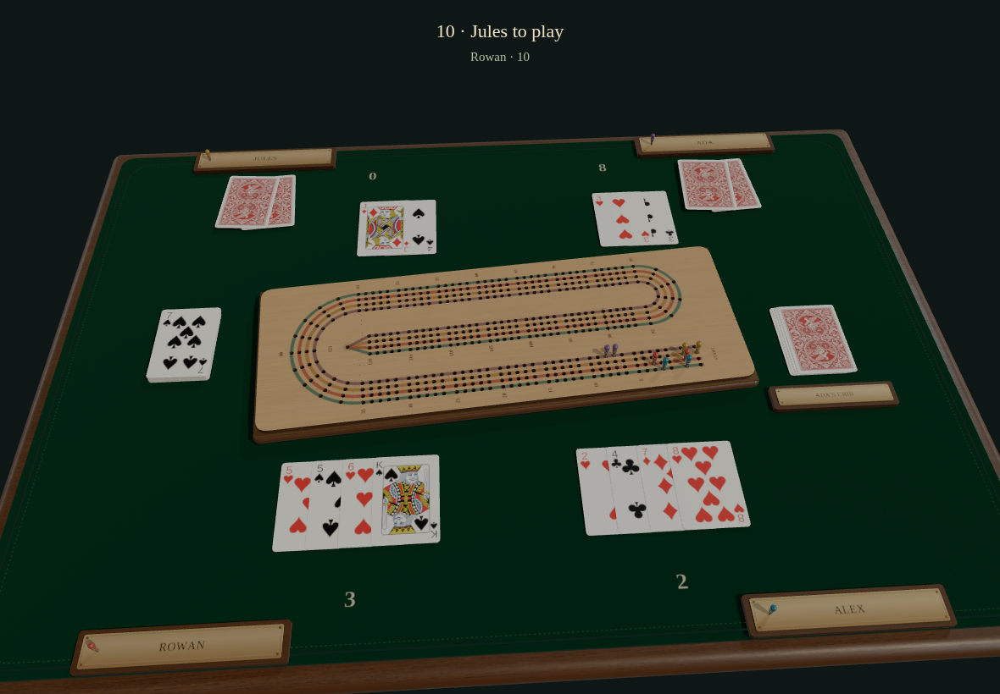

- [x] Exact phase, revision, round, count, crib size, clockwise seats, scores, private hands, public plays and legal native-card controls

## Rowan · plays King of spades automatically · observer

Viewpoint: **Alex**

- [x] Exact phase, revision, round, count, crib size, clockwise seats, scores, private hands, public plays and legal native-card controls

## Rowan · plays King of spades automatically · observer

Viewpoint: **Jules**

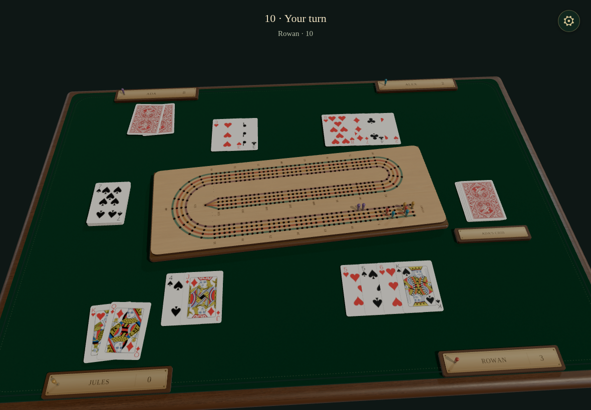

- [x] Exact phase, revision, round, count, crib size, clockwise seats, scores, private hands, public plays and legal native-card controls

## Rowan · plays King of spades automatically · observer

Viewpoint: **Ada**

- [x] Exact phase, revision, round, count, crib size, clockwise seats, scores, private hands, public plays and legal native-card controls

## Jules plays King of hearts · actor

Viewpoint: **Jules**

- [x] Exact phase, revision, round, count, crib size, clockwise seats, scores, private hands, public plays and legal native-card controls

## Jules plays King of hearts · observer

Viewpoint: **Alex**

- [x] Exact phase, revision, round, count, crib size, clockwise seats, scores, private hands, public plays and legal native-card controls

## Jules plays King of hearts · observer

Viewpoint: **Rowan**

- [x] Exact phase, revision, round, count, crib size, clockwise seats, scores, private hands, public plays and legal native-card controls

## Jules plays King of hearts · observer

Viewpoint: **Ada**

- [x] Exact phase, revision, round, count, crib size, clockwise seats, scores, private hands, public plays and legal native-card controls

## Ada plays 9 of clubs · actor

Viewpoint: **Ada**

- [x] Exact phase, revision, round, count, crib size, clockwise seats, scores, private hands, public plays and legal native-card controls

## Ada plays 9 of clubs · observer

Viewpoint: **Alex**

- [x] Exact phase, revision, round, count, crib size, clockwise seats, scores, private hands, public plays and legal native-card controls

## Ada plays 9 of clubs · observer

Viewpoint: **Rowan**

- [x] Exact phase, revision, round, count, crib size, clockwise seats, scores, private hands, public plays and legal native-card controls

## Ada plays 9 of clubs · observer

Viewpoint: **Jules**

- [x] Exact phase, revision, round, count, crib size, clockwise seats, scores, private hands, public plays and legal native-card controls

## Jules · go automatically · actor

Viewpoint: **Jules**

- [x] Exact phase, revision, round, count, crib size, clockwise seats, scores, private hands, public plays and legal native-card controls

## Jules · go automatically · observer

Viewpoint: **Alex**

- [x] Exact phase, revision, round, count, crib size, clockwise seats, scores, private hands, public plays and legal native-card controls

## Jules · go automatically · observer

Viewpoint: **Rowan**

- [x] Exact phase, revision, round, count, crib size, clockwise seats, scores, private hands, public plays and legal native-card controls

## Jules · go automatically · observer

Viewpoint: **Ada**

- [x] Exact phase, revision, round, count, crib size, clockwise seats, scores, private hands, public plays and legal native-card controls

## Ada · go automatically · actor

Viewpoint: **Ada**

- [x] Exact phase, revision, round, count, crib size, clockwise seats, scores, private hands, public plays and legal native-card controls

## Ada · go automatically · observer

Viewpoint: **Alex**

- [x] Exact phase, revision, round, count, crib size, clockwise seats, scores, private hands, public plays and legal native-card controls

## Ada · go automatically · observer

Viewpoint: **Rowan**

- [x] Exact phase, revision, round, count, crib size, clockwise seats, scores, private hands, public plays and legal native-card controls

## Ada · go automatically · observer

Viewpoint: **Jules**

- [x] Exact phase, revision, round, count, crib size, clockwise seats, scores, private hands, public plays and legal native-card controls

## Jules · plays Queen of diamonds automatically · actor

Viewpoint: **Jules**

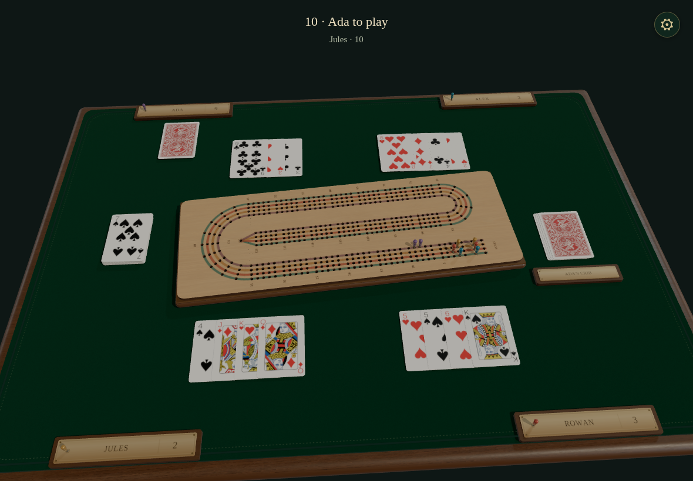

- [x] Exact phase, revision, round, count, crib size, clockwise seats, scores, private hands, public plays and legal native-card controls

## Jules · plays Queen of diamonds automatically · observer

Viewpoint: **Alex**

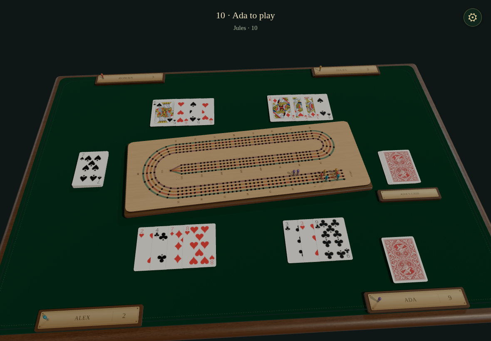

- [x] Exact phase, revision, round, count, crib size, clockwise seats, scores, private hands, public plays and legal native-card controls

## Jules · plays Queen of diamonds automatically · observer

Viewpoint: **Rowan**

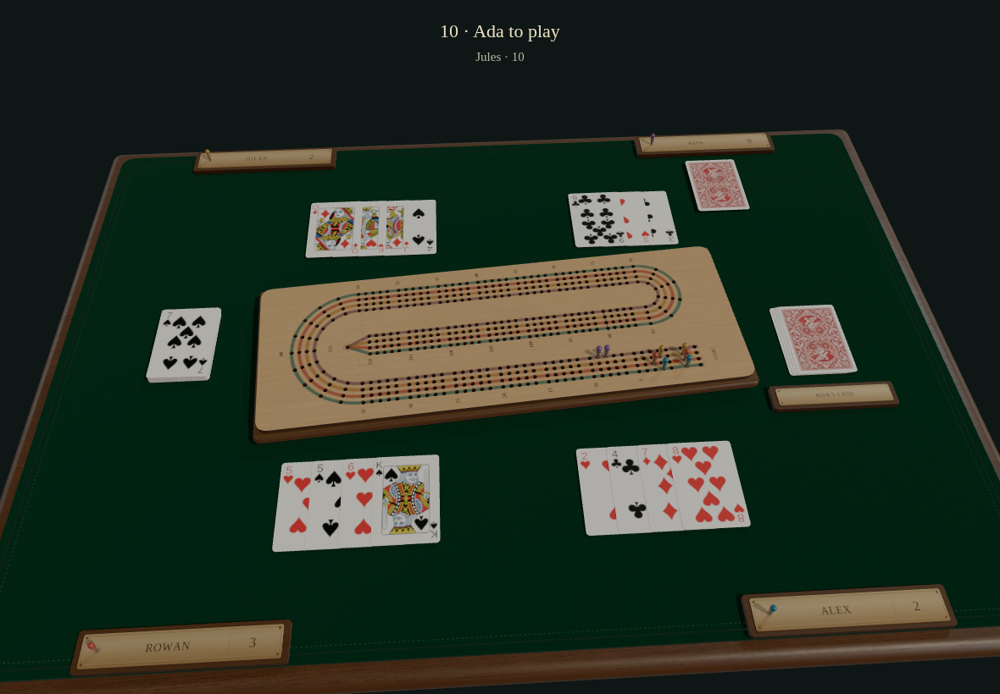

- [x] Exact phase, revision, round, count, crib size, clockwise seats, scores, private hands, public plays and legal native-card controls

## Jules · plays Queen of diamonds automatically · observer

Viewpoint: **Ada**

- [x] Exact phase, revision, round, count, crib size, clockwise seats, scores, private hands, public plays and legal native-card controls

## Ada · plays Jack of clubs automatically · actor

Viewpoint: **Ada**

- [x] Exact phase, revision, round, count, crib size, clockwise seats, scores, private hands, public plays and legal native-card controls

## Ada · plays Jack of clubs automatically · observer

Viewpoint: **Alex**

- [x] Exact phase, revision, round, count, crib size, clockwise seats, scores, private hands, public plays and legal native-card controls

## Ada · plays Jack of clubs automatically · observer

Viewpoint: **Rowan**

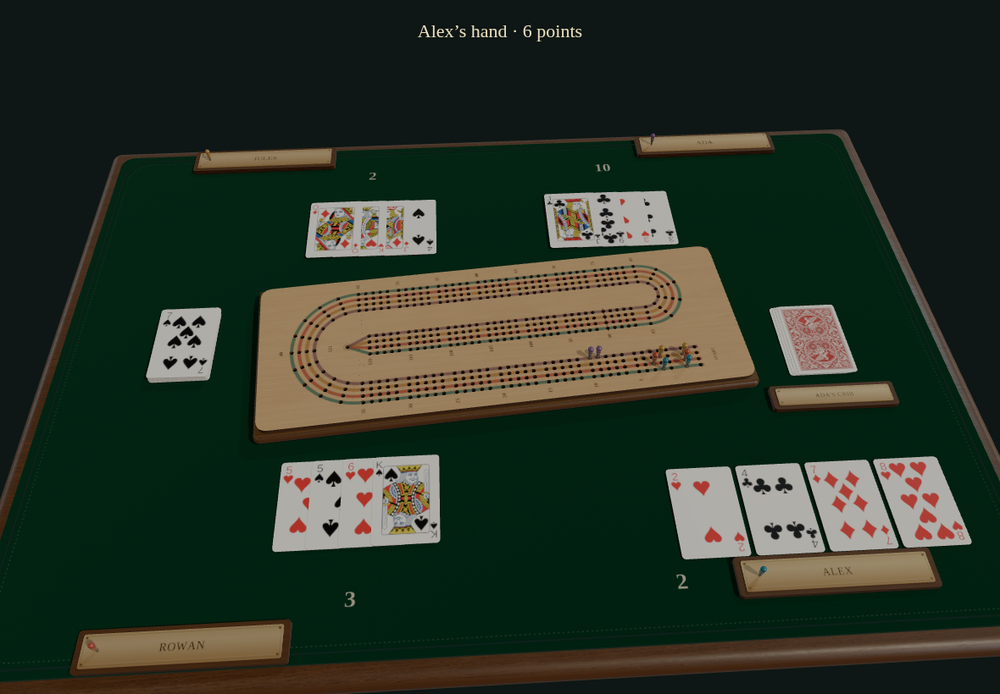

- [x] Exact phase, revision, round, count, crib size, clockwise seats, scores, private hands, public plays and legal native-card controls

## Ada · plays Jack of clubs automatically · observer

Viewpoint: **Jules**

- [x] Exact phase, revision, round, count, crib size, clockwise seats, scores, private hands, public plays and legal native-card controls

## Alex · pegs automatically · actor

Viewpoint: **Alex**

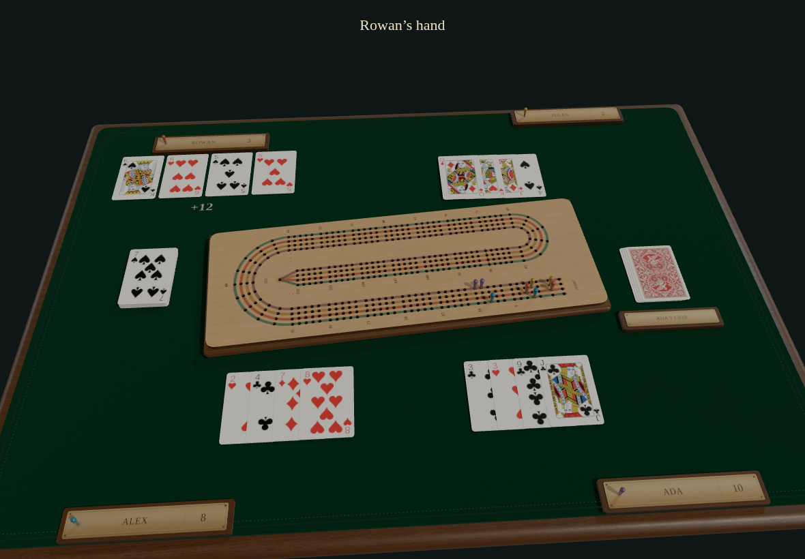

- [x] Exact phase, revision, round, count, crib size, clockwise seats, scores, private hands, public plays and legal native-card controls

## Alex · pegs automatically · observer

Viewpoint: **Rowan**

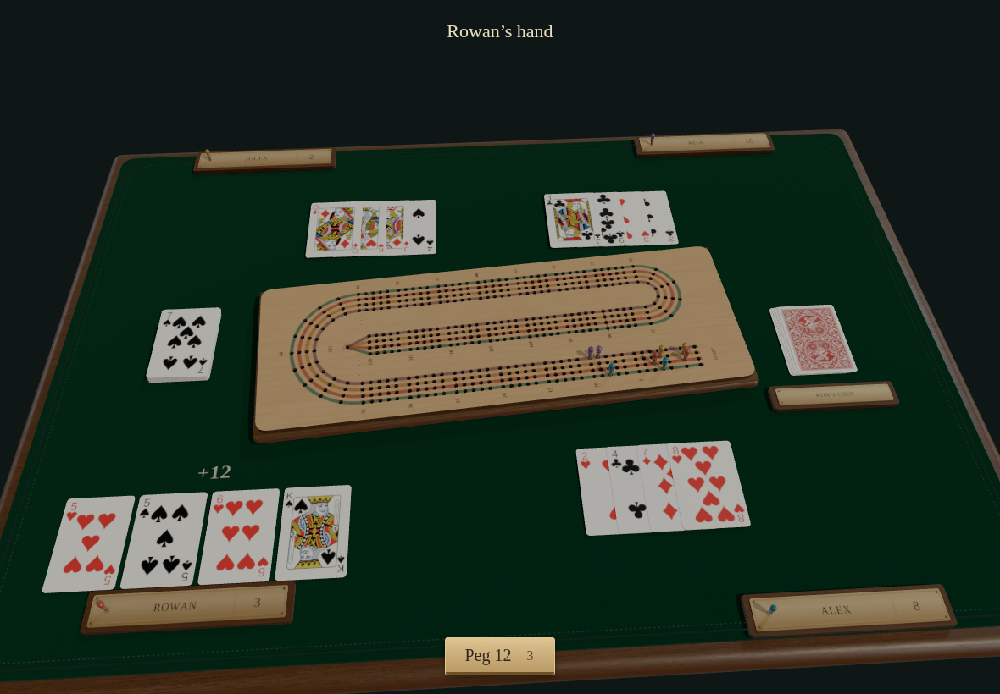

- [x] Exact phase, revision, round, count, crib size, clockwise seats, scores, private hands, public plays and legal native-card controls

## Alex · pegs automatically · observer

Viewpoint: **Jules**

- [x] Exact phase, revision, round, count, crib size, clockwise seats, scores, private hands, public plays and legal native-card controls

## Alex · pegs automatically · observer

Viewpoint: **Ada**

- [x] Exact phase, revision, round, count, crib size, clockwise seats, scores, private hands, public plays and legal native-card controls

## Rowan · pegs automatically · actor

Viewpoint: **Rowan**

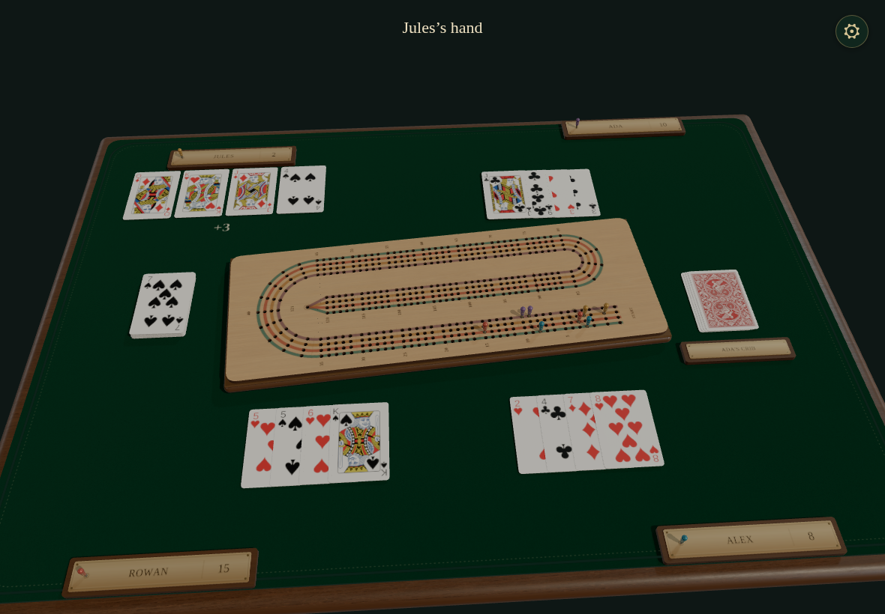

- [x] Exact phase, revision, round, count, crib size, clockwise seats, scores, private hands, public plays and legal native-card controls

## Rowan · pegs automatically · observer

Viewpoint: **Alex**

- [x] Exact phase, revision, round, count, crib size, clockwise seats, scores, private hands, public plays and legal native-card controls

## Rowan · pegs automatically · observer

Viewpoint: **Jules**

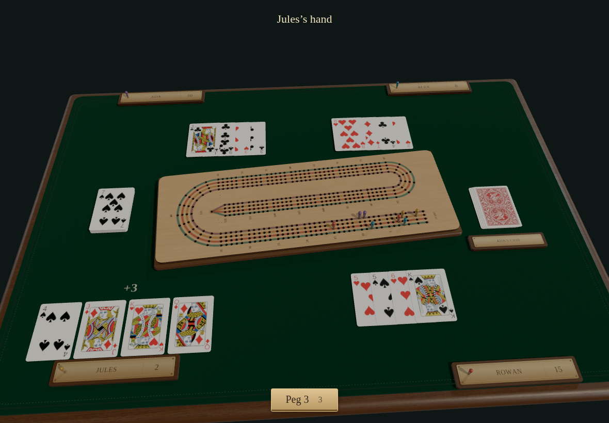

- [x] Exact phase, revision, round, count, crib size, clockwise seats, scores, private hands, public plays and legal native-card controls

## Rowan · pegs automatically · observer

Viewpoint: **Ada**

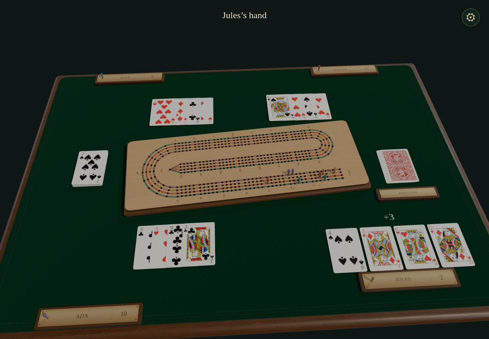

- [x] Exact phase, revision, round, count, crib size, clockwise seats, scores, private hands, public plays and legal native-card controls

## Jules · pegs automatically · actor

Viewpoint: **Jules**

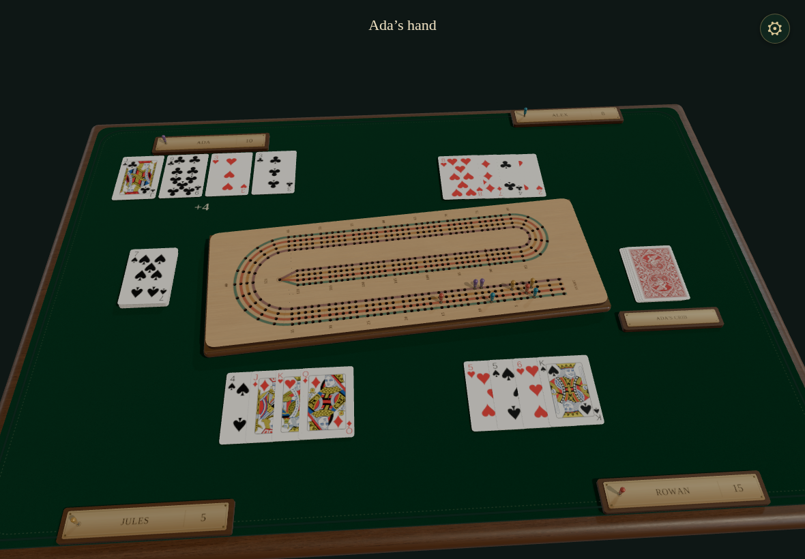

- [x] Exact phase, revision, round, count, crib size, clockwise seats, scores, private hands, public plays and legal native-card controls

## Jules · pegs automatically · observer

Viewpoint: **Alex**

- [x] Exact phase, revision, round, count, crib size, clockwise seats, scores, private hands, public plays and legal native-card controls

## Jules · pegs automatically · observer

Viewpoint: **Rowan**

- [x] Exact phase, revision, round, count, crib size, clockwise seats, scores, private hands, public plays and legal native-card controls

## Jules · pegs automatically · observer

Viewpoint: **Ada**

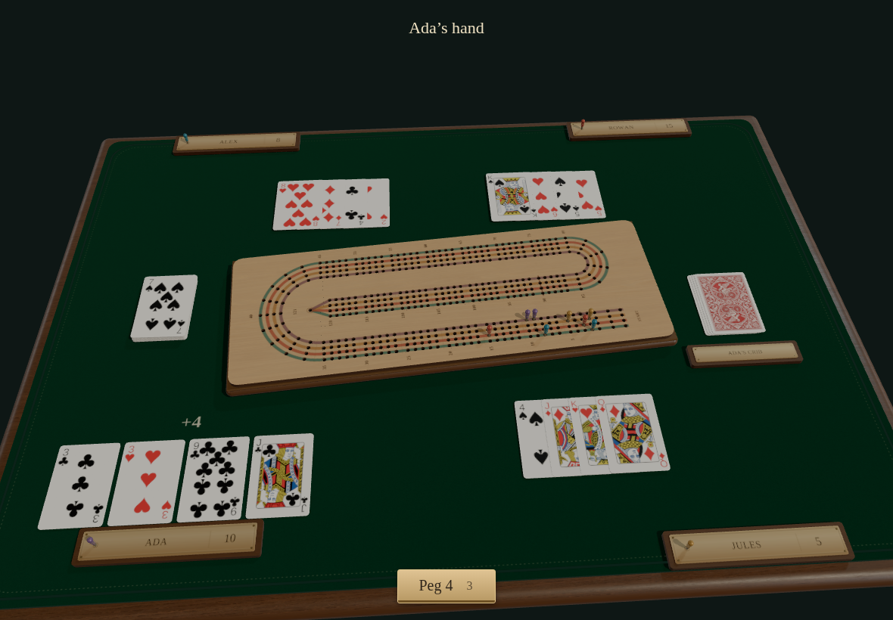

- [x] Exact phase, revision, round, count, crib size, clockwise seats, scores, private hands, public plays and legal native-card controls

## Ada · pegs automatically · actor

Viewpoint: **Ada**

- [x] Exact phase, revision, round, count, crib size, clockwise seats, scores, private hands, public plays and legal native-card controls

## Ada · pegs automatically · observer

Viewpoint: **Alex**

- [x] Exact phase, revision, round, count, crib size, clockwise seats, scores, private hands, public plays and legal native-card controls

## Ada · pegs automatically · observer

Viewpoint: **Rowan**

- [x] Exact phase, revision, round, count, crib size, clockwise seats, scores, private hands, public plays and legal native-card controls

## Ada · pegs automatically · observer

Viewpoint: **Jules**

- [x] Exact phase, revision, round, count, crib size, clockwise seats, scores, private hands, public plays and legal native-card controls

## Ada · pegs automatically · actor

Viewpoint: **Ada**

- [x] Exact phase, revision, round, count, crib size, clockwise seats, scores, private hands, public plays and legal native-card controls

## Ada · pegs automatically · observer

Viewpoint: **Alex**

- [x] Exact phase, revision, round, count, crib size, clockwise seats, scores, private hands, public plays and legal native-card controls

## Ada · pegs automatically · observer

Viewpoint: **Rowan**

- [x] Exact phase, revision, round, count, crib size, clockwise seats, scores, private hands, public plays and legal native-card controls

## Ada · pegs automatically · observer

Viewpoint: **Jules**

- [x] Exact phase, revision, round, count, crib size, clockwise seats, scores, private hands, public plays and legal native-card controls

## Ada · deal automatically · actor

Viewpoint: **Ada**

- [x] Exact phase, revision, round, count, crib size, clockwise seats, scores, private hands, public plays and legal native-card controls

## Ada · deal automatically · observer

Viewpoint: **Alex**

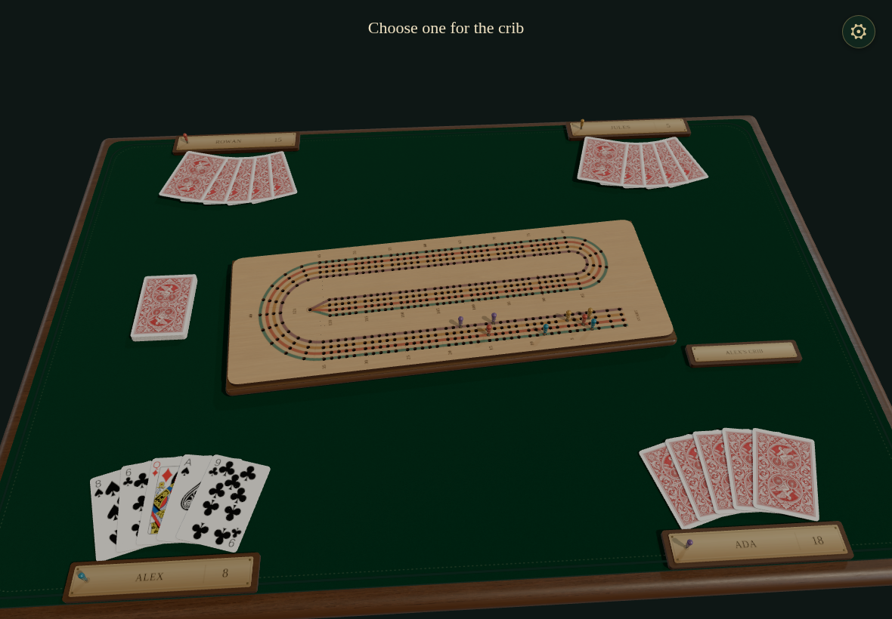

- [x] Exact phase, revision, round, count, crib size, clockwise seats, scores, private hands, public plays and legal native-card controls

## Ada · deal automatically · observer

Viewpoint: **Rowan**

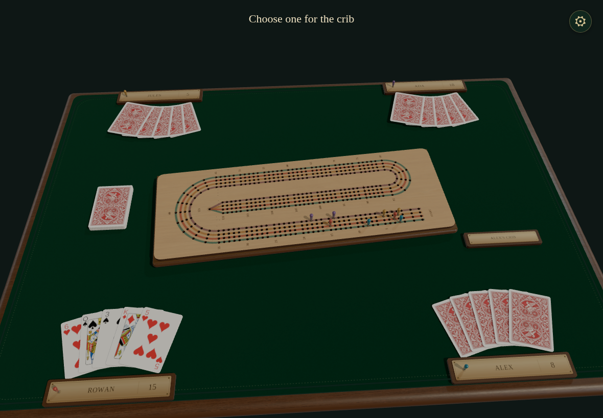

- [x] Exact phase, revision, round, count, crib size, clockwise seats, scores, private hands, public plays and legal native-card controls

## Ada · deal automatically · observer

Viewpoint: **Jules**

- [x] Exact phase, revision, round, count, crib size, clockwise seats, scores, private hands, public plays and legal native-card controls

## Jules returns to the same seat and hand · actor

Viewpoint: **Jules**

- [x] Exact phase, revision, round, count, crib size, clockwise seats, scores, private hands, public plays and legal native-card controls

## Jules returns to the same seat and hand · observer

Viewpoint: **Alex**

- [x] Exact phase, revision, round, count, crib size, clockwise seats, scores, private hands, public plays and legal native-card controls

## Jules returns to the same seat and hand · observer

Viewpoint: **Rowan**

- [x] Exact phase, revision, round, count, crib size, clockwise seats, scores, private hands, public plays and legal native-card controls

## Jules returns to the same seat and hand · observer

Viewpoint: **Ada**

- [x] Exact phase, revision, round, count, crib size, clockwise seats, scores, private hands, public plays and legal native-card controls
