# Two friends at the cribbage table

Every user action is followed by the actor's view and all seated observers. All captures are 1180×820 at 1×; verification allows zero different pixels.

## Alex opens the table · actor

Viewpoint: **Alex**

- [x] Exact phase, revision, round, count, crib size, clockwise seats, scores, private hands, public plays and legal native-card controls

## Rowan takes a chair · actor

Viewpoint: **Rowan**

- [x] Exact phase, revision, round, count, crib size, clockwise seats, scores, private hands, public plays and legal native-card controls

## Rowan takes a chair · observer

Viewpoint: **Alex**

- [x] Exact phase, revision, round, count, crib size, clockwise seats, scores, private hands, public plays and legal native-card controls

## Alex copies the invitation · actor

Viewpoint: **Alex**

- [x] Exact phase, revision, round, count, crib size, clockwise seats, scores, private hands, public plays and legal native-card controls

## Alex copies the invitation · observer

Viewpoint: **Rowan**

- [x] Exact phase, revision, round, count, crib size, clockwise seats, scores, private hands, public plays and legal native-card controls

## Alex deals six cards to everyone · actor

Viewpoint: **Alex**

- [x] Exact phase, revision, round, count, crib size, clockwise seats, scores, private hands, public plays and legal native-card controls

## Alex deals six cards to everyone · observer

Viewpoint: **Rowan**

- [x] Exact phase, revision, round, count, crib size, clockwise seats, scores, private hands, public plays and legal native-card controls

## Alex puts 7 of diamonds in the crib · actor

Viewpoint: **Alex**

- [x] Exact phase, revision, round, count, crib size, clockwise seats, scores, private hands, public plays and legal native-card controls

## Alex puts 7 of diamonds in the crib · observer

Viewpoint: **Rowan**

- [x] Exact phase, revision, round, count, crib size, clockwise seats, scores, private hands, public plays and legal native-card controls

## Alex puts 9 of spades in the crib · actor

Viewpoint: **Alex**

- [x] Exact phase, revision, round, count, crib size, clockwise seats, scores, private hands, public plays and legal native-card controls

## Alex puts 9 of spades in the crib · observer

Viewpoint: **Rowan**

- [x] Exact phase, revision, round, count, crib size, clockwise seats, scores, private hands, public plays and legal native-card controls

## Rowan puts 2 of hearts in the crib · actor

Viewpoint: **Rowan**

- [x] Exact phase, revision, round, count, crib size, clockwise seats, scores, private hands, public plays and legal native-card controls

## Rowan puts 2 of hearts in the crib · observer

Viewpoint: **Alex**

- [x] Exact phase, revision, round, count, crib size, clockwise seats, scores, private hands, public plays and legal native-card controls

## Rowan puts Ace of clubs in the crib · actor

Viewpoint: **Rowan**

- [x] Exact phase, revision, round, count, crib size, clockwise seats, scores, private hands, public plays and legal native-card controls

## Rowan puts Ace of clubs in the crib · observer

Viewpoint: **Alex**

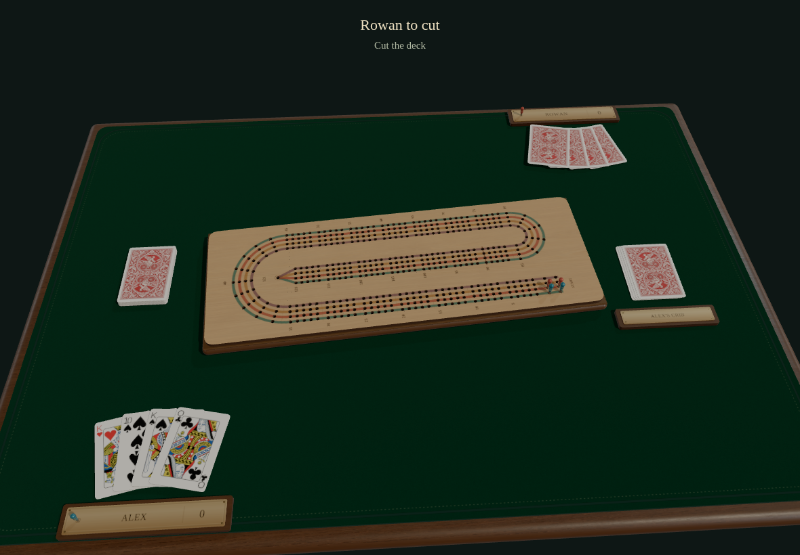

- [x] Exact phase, revision, round, count, crib size, clockwise seats, scores, private hands, public plays and legal native-card controls

## Rowan cuts the deck · actor

Viewpoint: **Rowan**

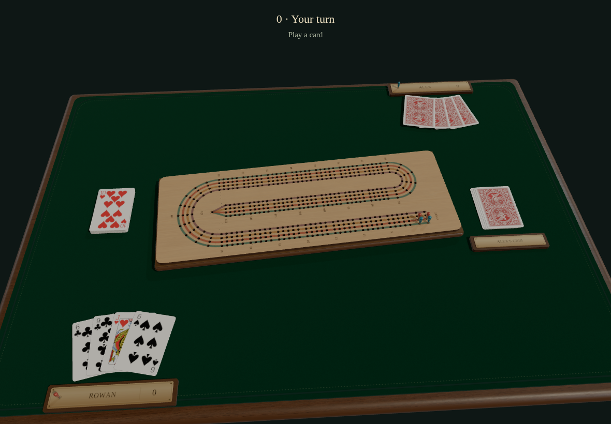

- [x] Exact phase, revision, round, count, crib size, clockwise seats, scores, private hands, public plays and legal native-card controls

## Rowan cuts the deck · observer

Viewpoint: **Alex**

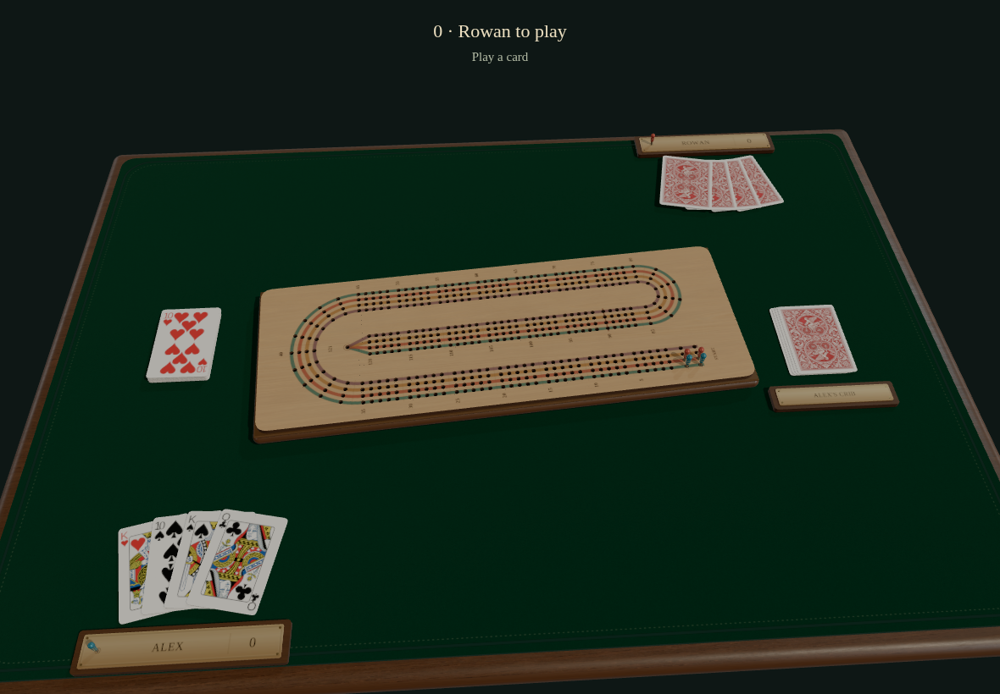

- [x] Exact phase, revision, round, count, crib size, clockwise seats, scores, private hands, public plays and legal native-card controls

## Rowan plays 6 of clubs · actor

Viewpoint: **Rowan**

- [x] Exact phase, revision, round, count, crib size, clockwise seats, scores, private hands, public plays and legal native-card controls

## Rowan plays 6 of clubs · observer

Viewpoint: **Alex**

- [x] Exact phase, revision, round, count, crib size, clockwise seats, scores, private hands, public plays and legal native-card controls

## Alex plays 10 of spades · actor

Viewpoint: **Alex**

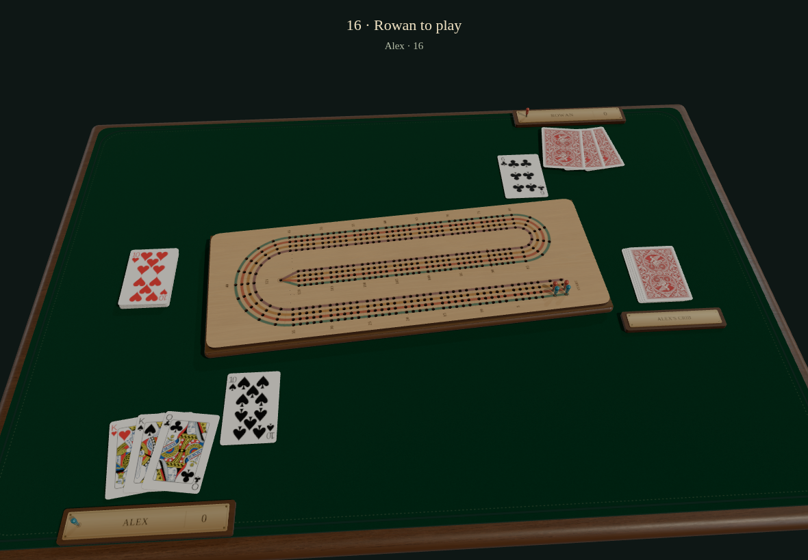

- [x] Exact phase, revision, round, count, crib size, clockwise seats, scores, private hands, public plays and legal native-card controls

## Alex plays 10 of spades · observer

Viewpoint: **Rowan**

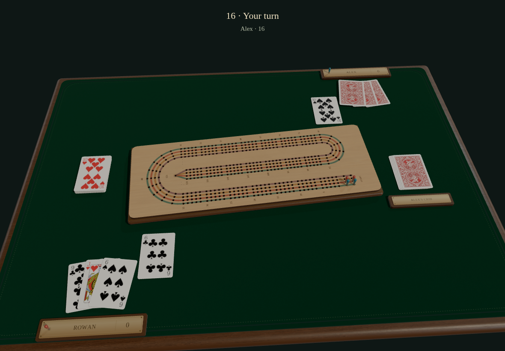

- [x] Exact phase, revision, round, count, crib size, clockwise seats, scores, private hands, public plays and legal native-card controls

## Rowan plays 6 of spades · actor

Viewpoint: **Rowan**

- [x] Exact phase, revision, round, count, crib size, clockwise seats, scores, private hands, public plays and legal native-card controls

## Rowan plays 6 of spades · observer

Viewpoint: **Alex**

- [x] Exact phase, revision, round, count, crib size, clockwise seats, scores, private hands, public plays and legal native-card controls

## Alex says Go · actor

Viewpoint: **Alex**

- [x] Exact phase, revision, round, count, crib size, clockwise seats, scores, private hands, public plays and legal native-card controls

## Alex says Go · observer

Viewpoint: **Rowan**

- [x] Exact phase, revision, round, count, crib size, clockwise seats, scores, private hands, public plays and legal native-card controls

## Rowan plays 9 of clubs · actor

Viewpoint: **Rowan**

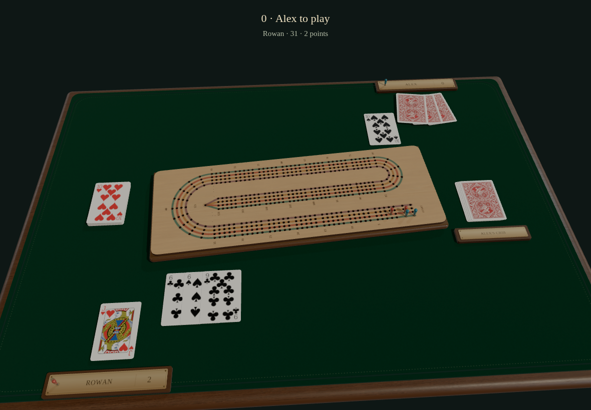

- [x] Exact phase, revision, round, count, crib size, clockwise seats, scores, private hands, public plays and legal native-card controls

## Rowan plays 9 of clubs · observer

Viewpoint: **Alex**

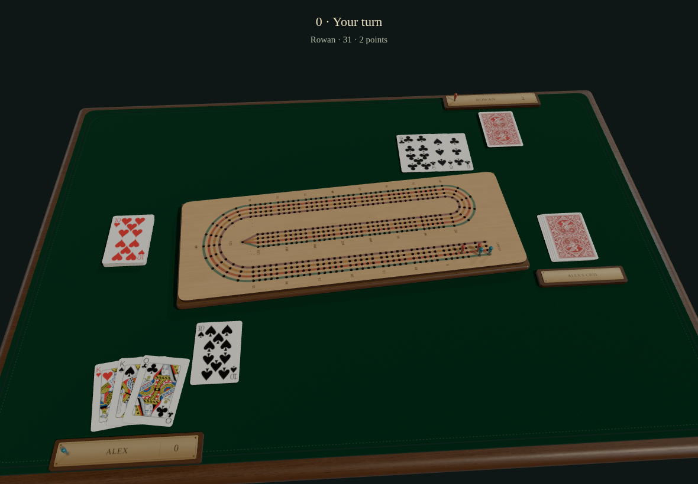

- [x] Exact phase, revision, round, count, crib size, clockwise seats, scores, private hands, public plays and legal native-card controls

## Alex plays King of hearts · actor

Viewpoint: **Alex**

- [x] Exact phase, revision, round, count, crib size, clockwise seats, scores, private hands, public plays and legal native-card controls

## Alex plays King of hearts · observer

Viewpoint: **Rowan**

- [x] Exact phase, revision, round, count, crib size, clockwise seats, scores, private hands, public plays and legal native-card controls

## Rowan plays Jack of hearts · actor

Viewpoint: **Rowan**

- [x] Exact phase, revision, round, count, crib size, clockwise seats, scores, private hands, public plays and legal native-card controls

## Rowan plays Jack of hearts · observer

Viewpoint: **Alex**

- [x] Exact phase, revision, round, count, crib size, clockwise seats, scores, private hands, public plays and legal native-card controls

## Alex plays Queen of clubs · actor

Viewpoint: **Alex**

- [x] Exact phase, revision, round, count, crib size, clockwise seats, scores, private hands, public plays and legal native-card controls

## Alex plays Queen of clubs · observer

Viewpoint: **Rowan**

- [x] Exact phase, revision, round, count, crib size, clockwise seats, scores, private hands, public plays and legal native-card controls

## Alex says Go · actor

Viewpoint: **Alex**

- [x] Exact phase, revision, round, count, crib size, clockwise seats, scores, private hands, public plays and legal native-card controls

## Alex says Go · observer

Viewpoint: **Rowan**

- [x] Exact phase, revision, round, count, crib size, clockwise seats, scores, private hands, public plays and legal native-card controls

## Alex plays King of spades · actor

Viewpoint: **Alex**

- [x] Exact phase, revision, round, count, crib size, clockwise seats, scores, private hands, public plays and legal native-card controls

## Alex plays King of spades · observer

Viewpoint: **Rowan**

- [x] Exact phase, revision, round, count, crib size, clockwise seats, scores, private hands, public plays and legal native-card controls

## Rowan counts · actor

Viewpoint: **Rowan**

- [x] Exact phase, revision, round, count, crib size, clockwise seats, scores, private hands, public plays and legal native-card controls

## Rowan counts · observer

Viewpoint: **Alex**

- [x] Exact phase, revision, round, count, crib size, clockwise seats, scores, private hands, public plays and legal native-card controls

## Alex counts · actor

Viewpoint: **Alex**

- [x] Exact phase, revision, round, count, crib size, clockwise seats, scores, private hands, public plays and legal native-card controls

## Alex counts · observer

Viewpoint: **Rowan**

- [x] Exact phase, revision, round, count, crib size, clockwise seats, scores, private hands, public plays and legal native-card controls

## Alex counts · actor

Viewpoint: **Alex**

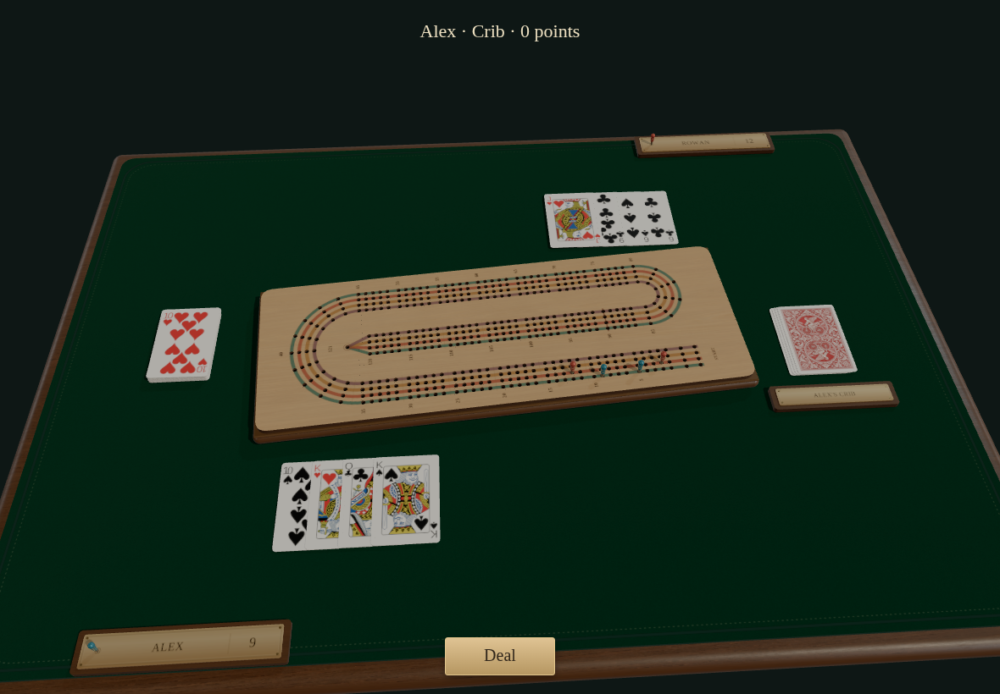

- [x] Exact phase, revision, round, count, crib size, clockwise seats, scores, private hands, public plays and legal native-card controls

## Alex counts · observer

Viewpoint: **Rowan**

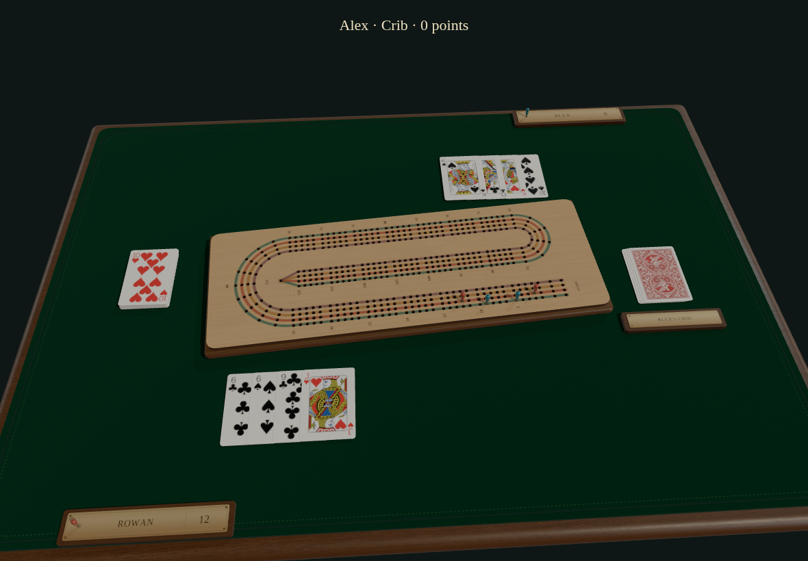

- [x] Exact phase, revision, round, count, crib size, clockwise seats, scores, private hands, public plays and legal native-card controls

## Alex deals the next hand · actor

Viewpoint: **Alex**

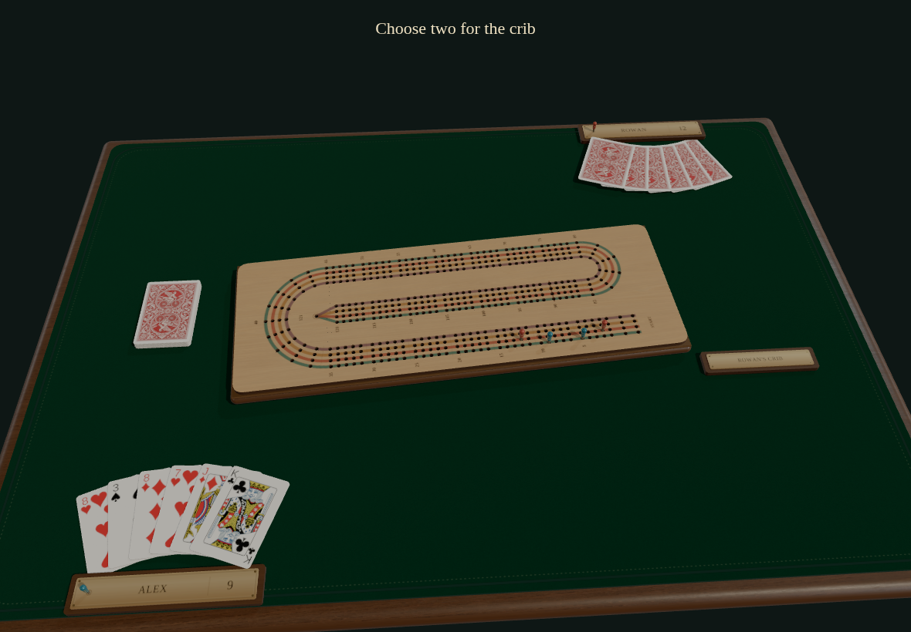

- [x] Exact phase, revision, round, count, crib size, clockwise seats, scores, private hands, public plays and legal native-card controls

## Alex deals the next hand · observer

Viewpoint: **Rowan**

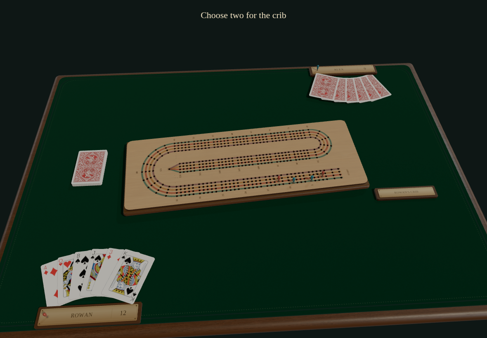

- [x] Exact phase, revision, round, count, crib size, clockwise seats, scores, private hands, public plays and legal native-card controls

## Rowan returns to the same seat and hand · actor

Viewpoint: **Rowan**

- [x] Exact phase, revision, round, count, crib size, clockwise seats, scores, private hands, public plays and legal native-card controls

## Rowan returns to the same seat and hand · observer

Viewpoint: **Alex**

- [x] Exact phase, revision, round, count, crib size, clockwise seats, scores, private hands, public plays and legal native-card controls
