# Two friends at the cribbage table

Every user action is followed by the actor's view and all seated observers. All captures are 1180×820 at 1×; verification allows zero different pixels.

## Alex opens the table · actor

Viewpoint: **Alex**

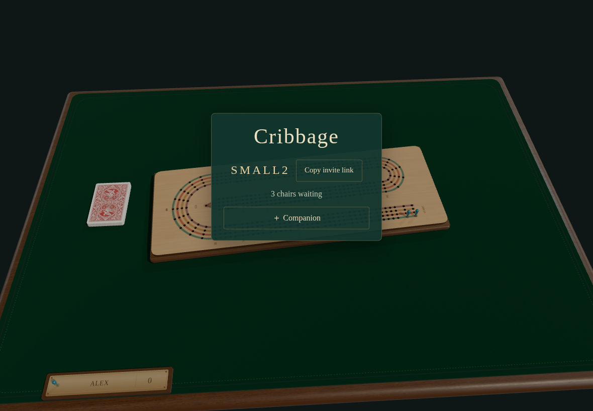

- [x] Exact phase, revision, round, count, crib size, clockwise seats, scores, private hands, public plays and legal native-card controls

## Rowan takes a chair · actor

Viewpoint: **Rowan**

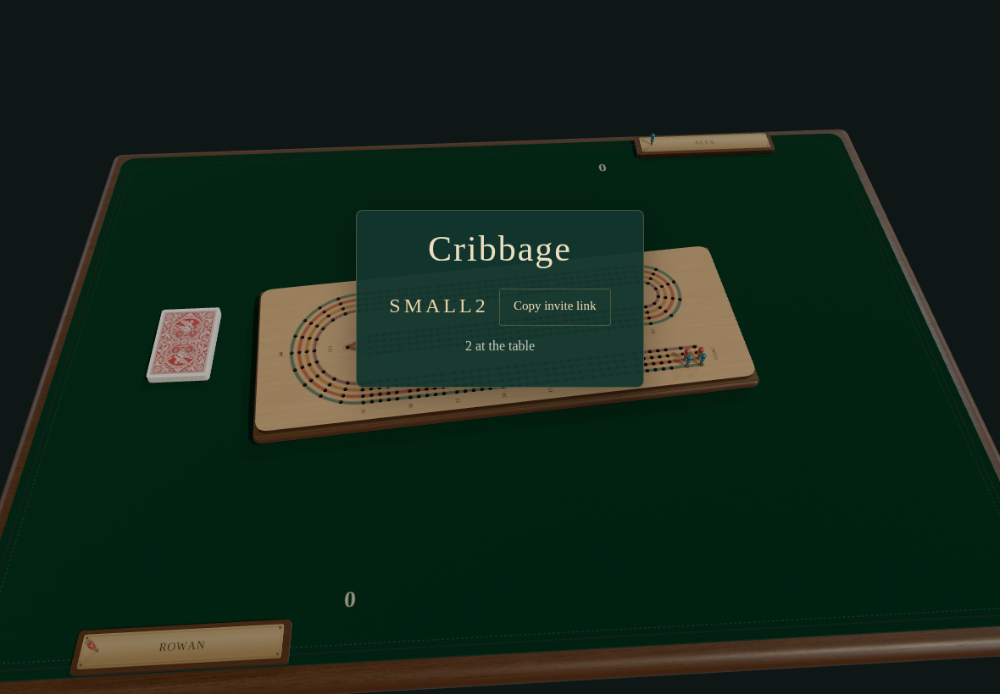

- [x] Exact phase, revision, round, count, crib size, clockwise seats, scores, private hands, public plays and legal native-card controls

## Rowan takes a chair · observer

Viewpoint: **Alex**

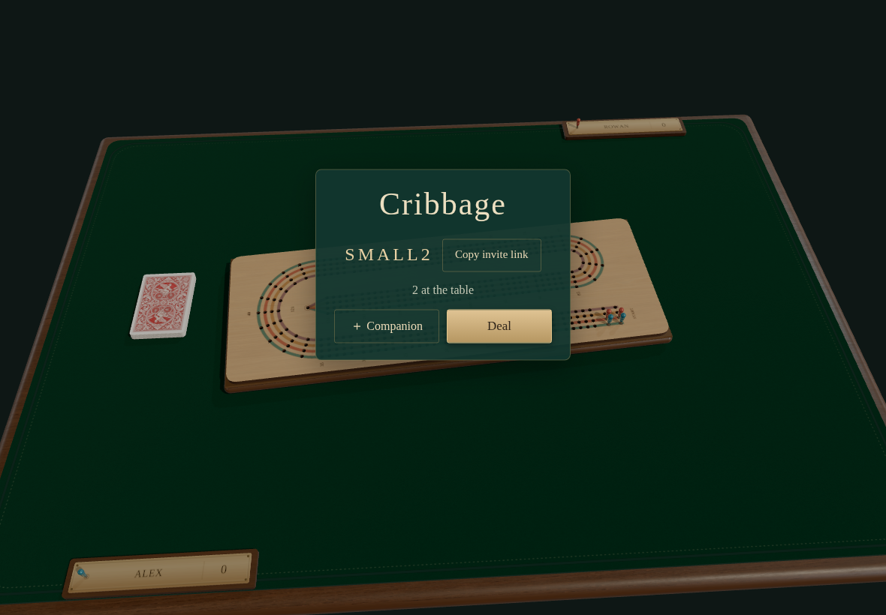

- [x] Exact phase, revision, round, count, crib size, clockwise seats, scores, private hands, public plays and legal native-card controls

## Alex copies the invitation · actor

Viewpoint: **Alex**

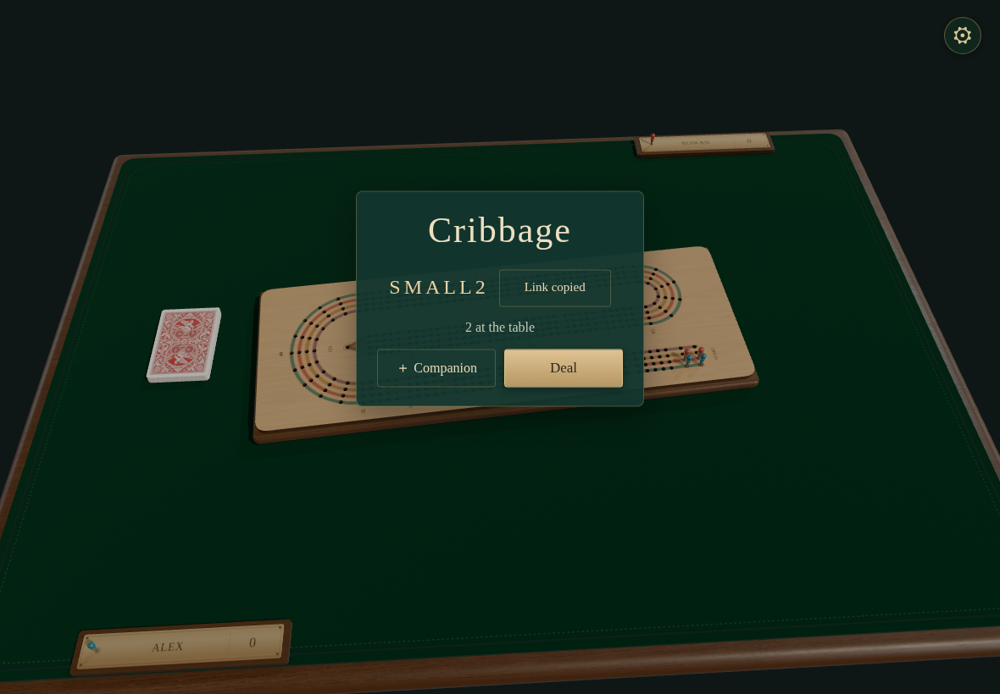

- [x] Exact phase, revision, round, count, crib size, clockwise seats, scores, private hands, public plays and legal native-card controls

## Alex copies the invitation · observer

Viewpoint: **Rowan**

- [x] Exact phase, revision, round, count, crib size, clockwise seats, scores, private hands, public plays and legal native-card controls

## Alex deals six cards to everyone · actor

Viewpoint: **Alex**

- [x] Exact phase, revision, round, count, crib size, clockwise seats, scores, private hands, public plays and legal native-card controls

## Alex deals six cards to everyone · observer

Viewpoint: **Rowan**

- [x] Exact phase, revision, round, count, crib size, clockwise seats, scores, private hands, public plays and legal native-card controls

## Alex puts 7 of diamonds in the crib · actor

Viewpoint: **Alex**

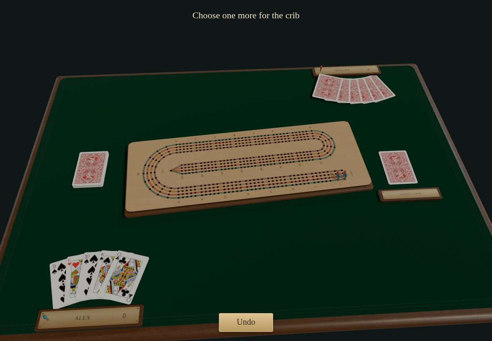

- [x] Exact phase, revision, round, count, crib size, clockwise seats, scores, private hands, public plays and legal native-card controls

## Alex puts 7 of diamonds in the crib · observer

Viewpoint: **Rowan**

- [x] Exact phase, revision, round, count, crib size, clockwise seats, scores, private hands, public plays and legal native-card controls

## The first crib card stays undoable after six seconds, with no countdown · actor

Viewpoint: **Alex**

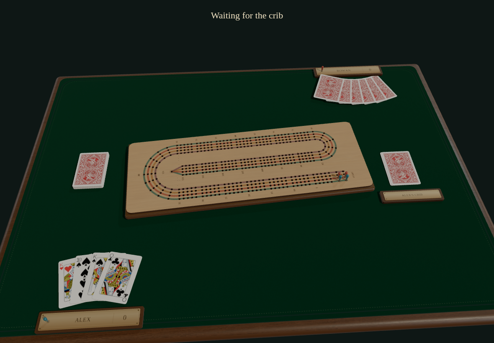

- [x] Exact phase, revision, round, count, crib size, clockwise seats, scores, private hands, public plays and legal native-card controls

## The first crib card stays undoable after six seconds, with no countdown · observer

Viewpoint: **Rowan**

- [x] Exact phase, revision, round, count, crib size, clockwise seats, scores, private hands, public plays and legal native-card controls

## Alex returns a crib card to their hand · actor

Viewpoint: **Alex**

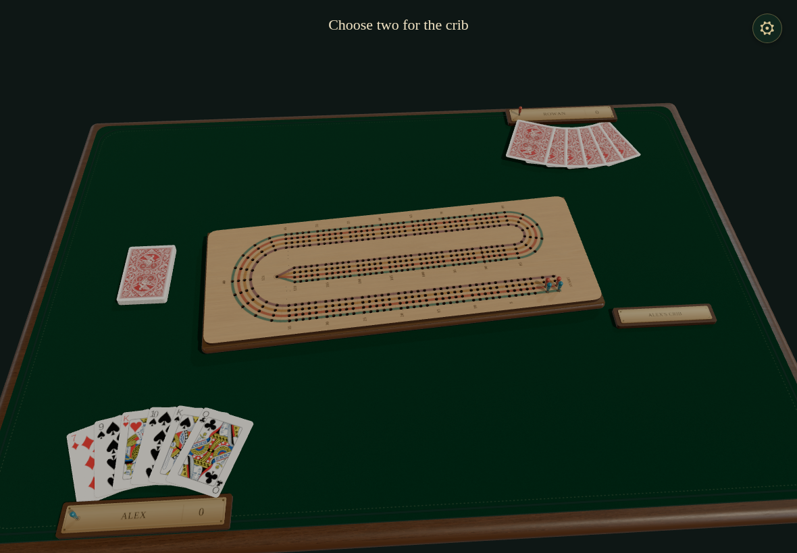

- [x] Exact phase, revision, round, count, crib size, clockwise seats, scores, private hands, public plays and legal native-card controls

## Alex returns a crib card to their hand · observer

Viewpoint: **Rowan**

- [x] Exact phase, revision, round, count, crib size, clockwise seats, scores, private hands, public plays and legal native-card controls

## Alex puts 7 of diamonds in the crib · actor

Viewpoint: **Alex**

- [x] Exact phase, revision, round, count, crib size, clockwise seats, scores, private hands, public plays and legal native-card controls

## Alex puts 7 of diamonds in the crib · observer

Viewpoint: **Rowan**

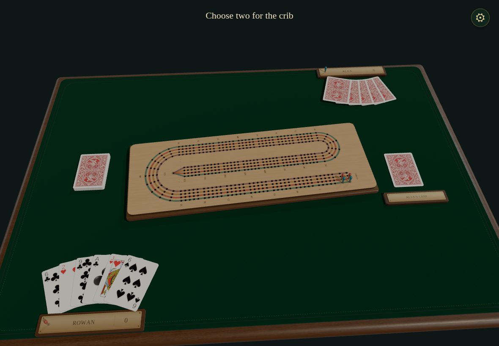

- [x] Exact phase, revision, round, count, crib size, clockwise seats, scores, private hands, public plays and legal native-card controls

## Alex puts 9 of spades in the crib · actor

Viewpoint: **Alex**

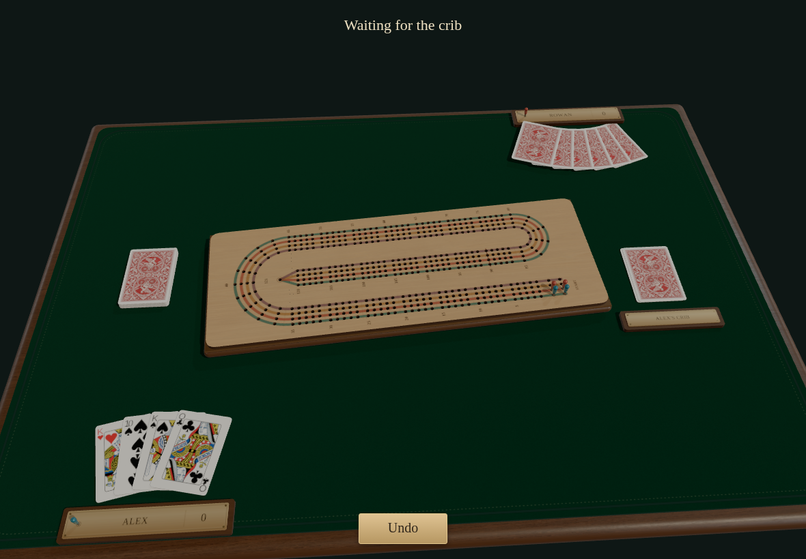

- [x] Exact phase, revision, round, count, crib size, clockwise seats, scores, private hands, public plays and legal native-card controls

## Alex puts 9 of spades in the crib · observer

Viewpoint: **Rowan**

- [x] Exact phase, revision, round, count, crib size, clockwise seats, scores, private hands, public plays and legal native-card controls

## Rowan puts 2 of hearts in the crib · actor

Viewpoint: **Rowan**

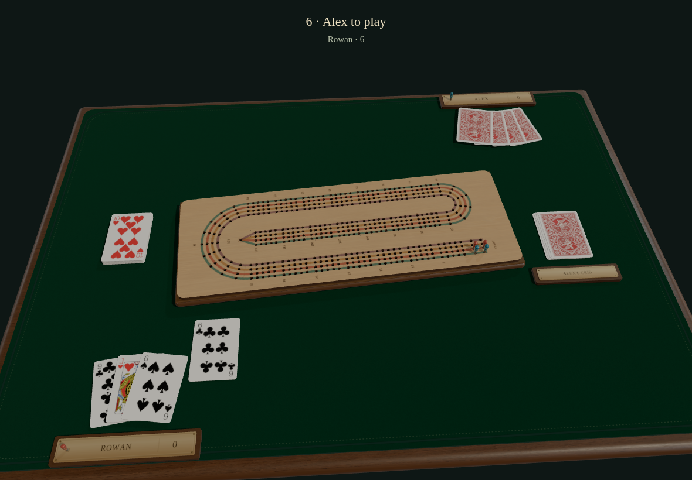

- [x] Exact phase, revision, round, count, crib size, clockwise seats, scores, private hands, public plays and legal native-card controls

## Rowan puts 2 of hearts in the crib · observer

Viewpoint: **Alex**

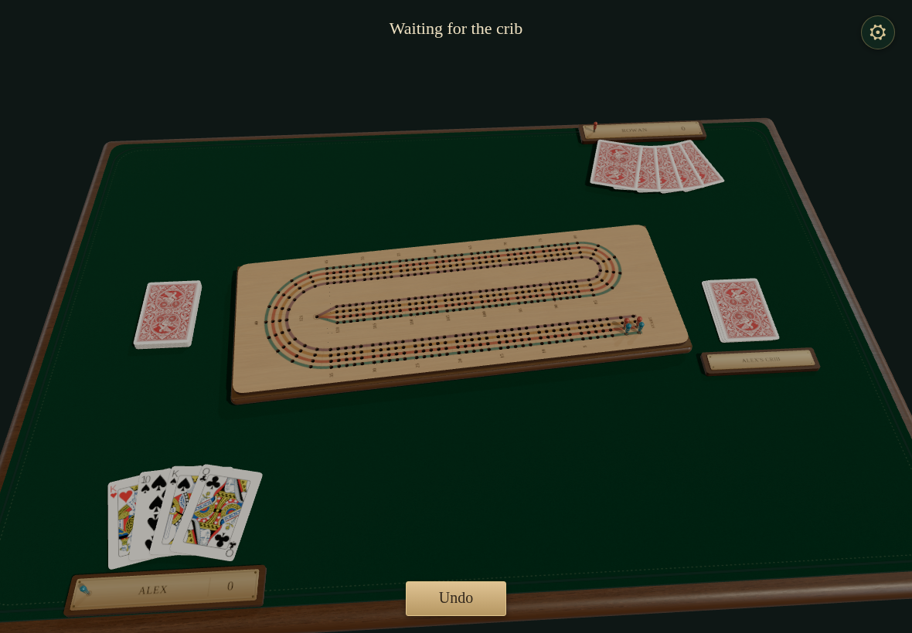

- [x] Exact phase, revision, round, count, crib size, clockwise seats, scores, private hands, public plays and legal native-card controls

## Rowan puts Ace of clubs in the crib · actor

Viewpoint: **Rowan**

- [x] Exact phase, revision, round, count, crib size, clockwise seats, scores, private hands, public plays and legal native-card controls

## Rowan puts Ace of clubs in the crib · observer

Viewpoint: **Alex**

- [x] Exact phase, revision, round, count, crib size, clockwise seats, scores, private hands, public plays and legal native-card controls

## One second remains after returning to the table · actor

Viewpoint: **Alex**

- [x] Exact phase, revision, round, count, crib size, clockwise seats, scores, private hands, public plays and legal native-card controls

## One second remains after returning to the table · observer

Viewpoint: **Rowan**

- [x] Exact phase, revision, round, count, crib size, clockwise seats, scores, private hands, public plays and legal native-card controls

## Alex returns a crib card to their hand · actor

Viewpoint: **Alex**

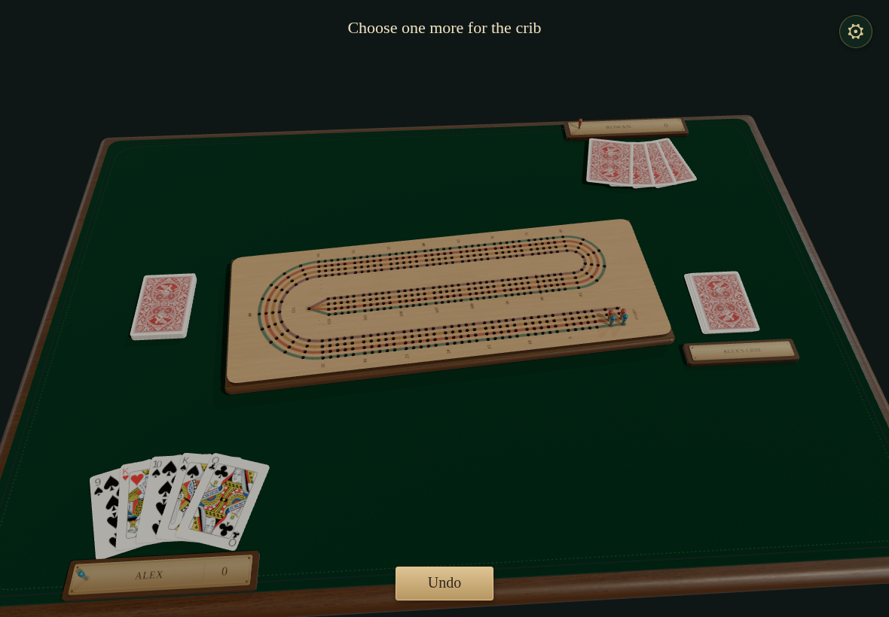

- [x] Exact phase, revision, round, count, crib size, clockwise seats, scores, private hands, public plays and legal native-card controls

## Alex returns a crib card to their hand · observer

Viewpoint: **Rowan**

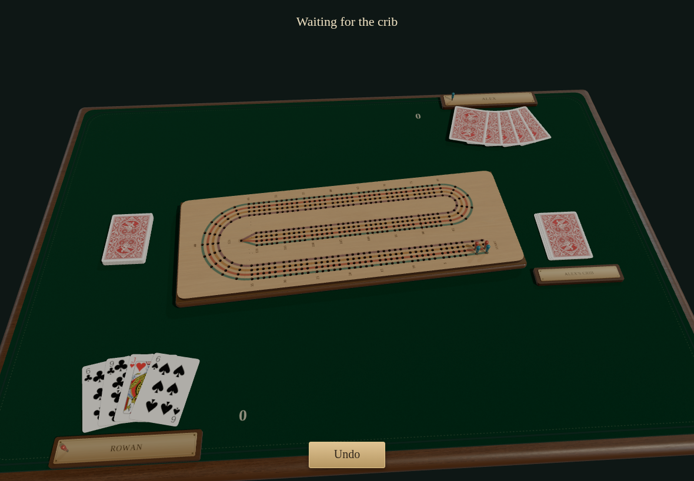

- [x] Exact phase, revision, round, count, crib size, clockwise seats, scores, private hands, public plays and legal native-card controls

## Alex puts 9 of spades in the crib · actor

Viewpoint: **Alex**

- [x] Exact phase, revision, round, count, crib size, clockwise seats, scores, private hands, public plays and legal native-card controls

## Alex puts 9 of spades in the crib · observer

Viewpoint: **Rowan**

- [x] Exact phase, revision, round, count, crib size, clockwise seats, scores, private hands, public plays and legal native-card controls

## Alex · the crib is ready · actor

Viewpoint: **Alex**

- [x] Exact phase, revision, round, count, crib size, clockwise seats, scores, private hands, public plays and legal native-card controls

## Alex · the crib is ready · observer

Viewpoint: **Rowan**

- [x] Exact phase, revision, round, count, crib size, clockwise seats, scores, private hands, public plays and legal native-card controls

## Rowan · cut automatically · actor

Viewpoint: **Rowan**

- [x] Exact phase, revision, round, count, crib size, clockwise seats, scores, private hands, public plays and legal native-card controls

## Rowan · cut automatically · observer

Viewpoint: **Alex**

- [x] Exact phase, revision, round, count, crib size, clockwise seats, scores, private hands, public plays and legal native-card controls

## Rowan plays 6 of clubs · actor

Viewpoint: **Rowan**

- [x] Exact phase, revision, round, count, crib size, clockwise seats, scores, private hands, public plays and legal native-card controls

## Rowan plays 6 of clubs · observer

Viewpoint: **Alex**

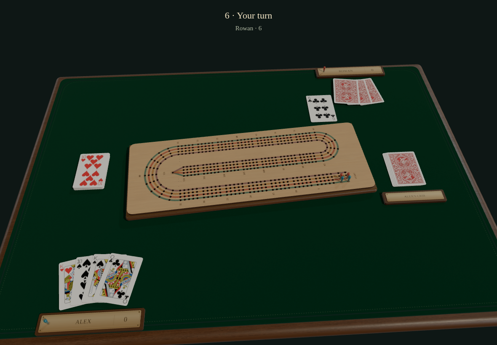

- [x] Exact phase, revision, round, count, crib size, clockwise seats, scores, private hands, public plays and legal native-card controls

## Alex plays 10 of spades · actor

Viewpoint: **Alex**

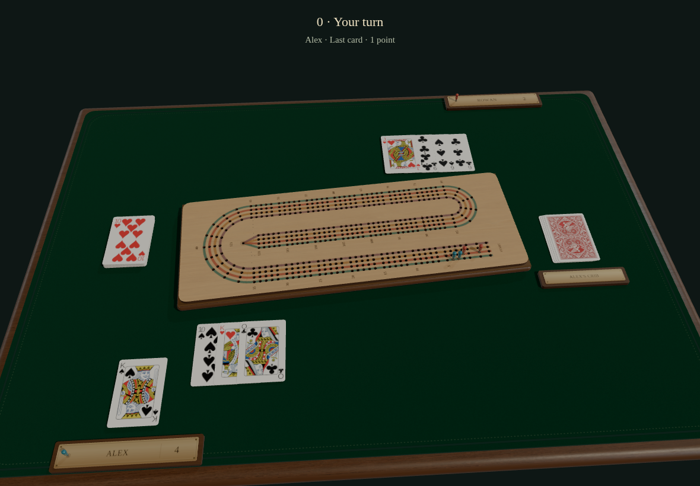

- [x] Exact phase, revision, round, count, crib size, clockwise seats, scores, private hands, public plays and legal native-card controls

## Alex plays 10 of spades · observer

Viewpoint: **Rowan**

- [x] Exact phase, revision, round, count, crib size, clockwise seats, scores, private hands, public plays and legal native-card controls

## Rowan plays 6 of spades · actor

Viewpoint: **Rowan**

- [x] Exact phase, revision, round, count, crib size, clockwise seats, scores, private hands, public plays and legal native-card controls

## Rowan plays 6 of spades · observer

Viewpoint: **Alex**

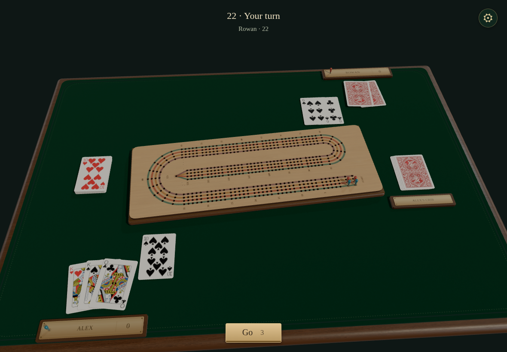

- [x] Exact phase, revision, round, count, crib size, clockwise seats, scores, private hands, public plays and legal native-card controls

## Go will play automatically in one second · actor

Viewpoint: **Alex**

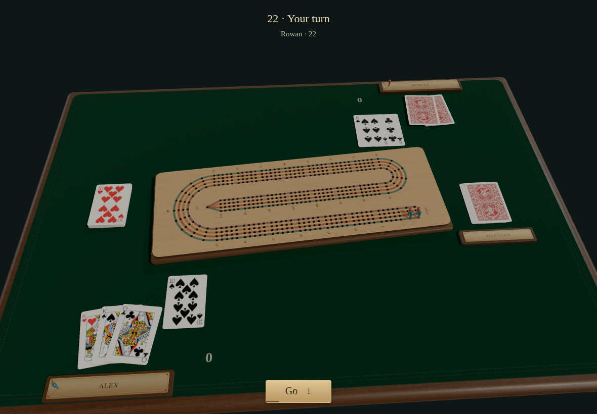

- [x] Exact phase, revision, round, count, crib size, clockwise seats, scores, private hands, public plays and legal native-card controls

## Go will play automatically in one second · observer

Viewpoint: **Rowan**

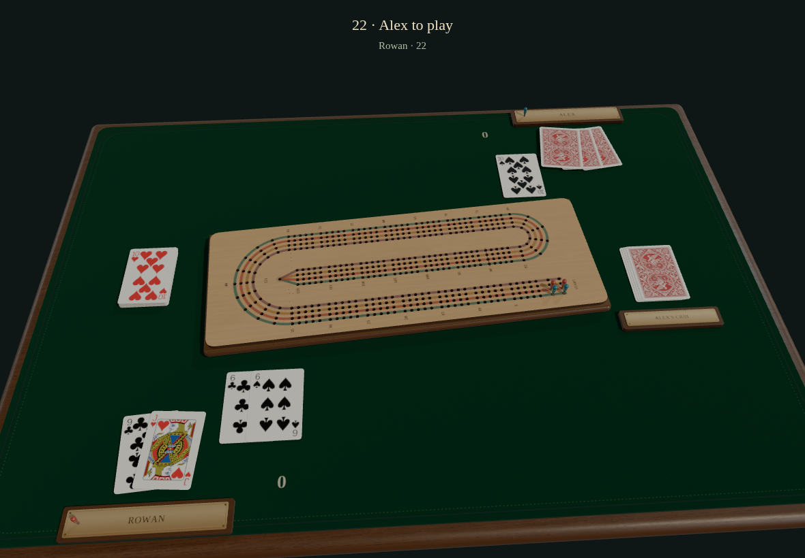

- [x] Exact phase, revision, round, count, crib size, clockwise seats, scores, private hands, public plays and legal native-card controls

## Alex · go automatically · actor

Viewpoint: **Alex**

- [x] Exact phase, revision, round, count, crib size, clockwise seats, scores, private hands, public plays and legal native-card controls

## Alex · go automatically · observer

Viewpoint: **Rowan**

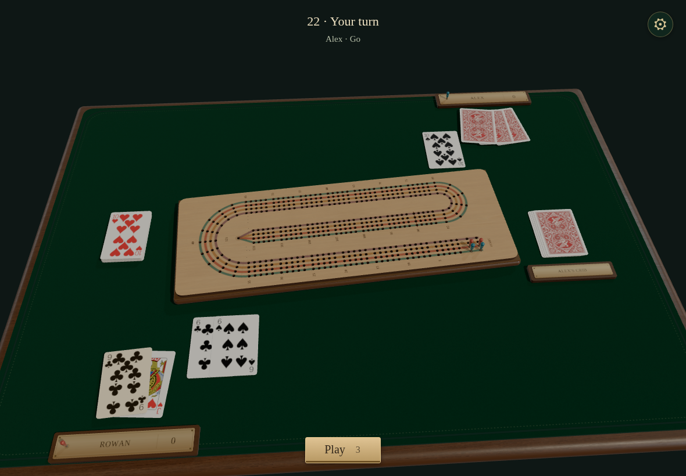

- [x] Exact phase, revision, round, count, crib size, clockwise seats, scores, private hands, public plays and legal native-card controls

## Manual timing leaves the only playable card in your hand · actor

Viewpoint: **Rowan**

- [x] Exact phase, revision, round, count, crib size, clockwise seats, scores, private hands, public plays and legal native-card controls

## Manual timing leaves the only playable card in your hand · observer

Viewpoint: **Alex**

- [x] Exact phase, revision, round, count, crib size, clockwise seats, scores, private hands, public plays and legal native-card controls

## The only playable card will play in one second after returning to the table · actor

Viewpoint: **Rowan**

- [x] Exact phase, revision, round, count, crib size, clockwise seats, scores, private hands, public plays and legal native-card controls

## The only playable card will play in one second after returning to the table · observer

Viewpoint: **Alex**

- [x] Exact phase, revision, round, count, crib size, clockwise seats, scores, private hands, public plays and legal native-card controls

## Rowan · plays 9 of clubs automatically · actor

Viewpoint: **Rowan**

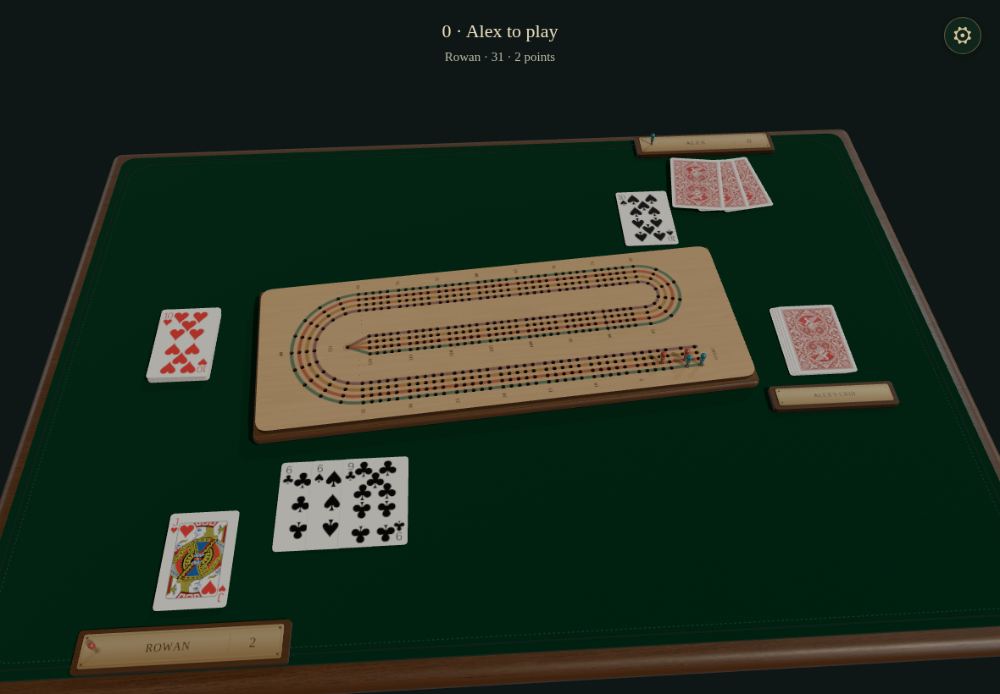

- [x] Exact phase, revision, round, count, crib size, clockwise seats, scores, private hands, public plays and legal native-card controls

## Rowan · plays 9 of clubs automatically · observer

Viewpoint: **Alex**

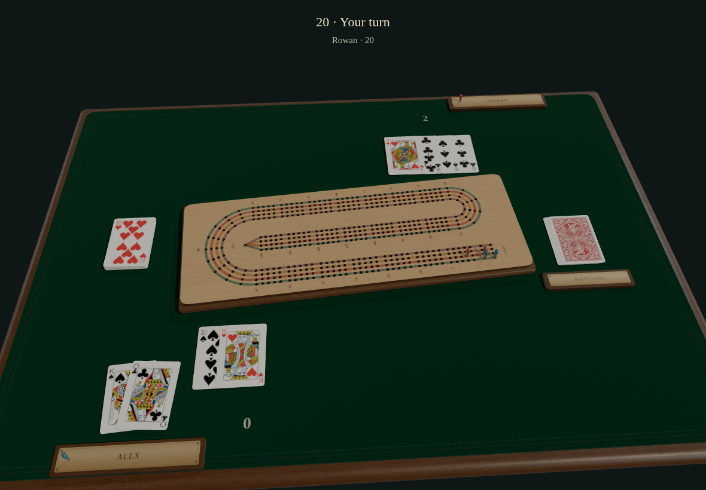

- [x] Exact phase, revision, round, count, crib size, clockwise seats, scores, private hands, public plays and legal native-card controls

## Alex plays King of hearts · actor

Viewpoint: **Alex**

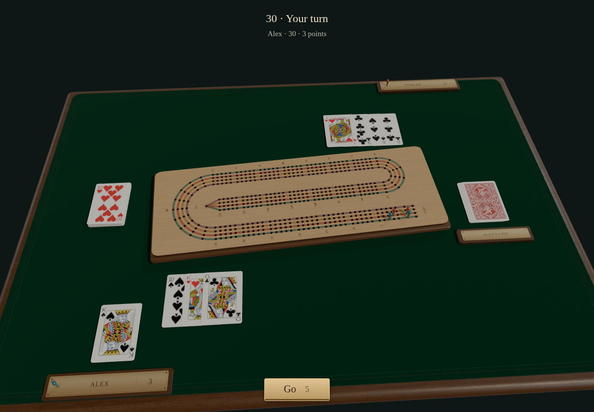

- [x] Exact phase, revision, round, count, crib size, clockwise seats, scores, private hands, public plays and legal native-card controls

## Alex plays King of hearts · observer

Viewpoint: **Rowan**

- [x] Exact phase, revision, round, count, crib size, clockwise seats, scores, private hands, public plays and legal native-card controls

## Rowan · plays Jack of hearts automatically · actor

Viewpoint: **Rowan**

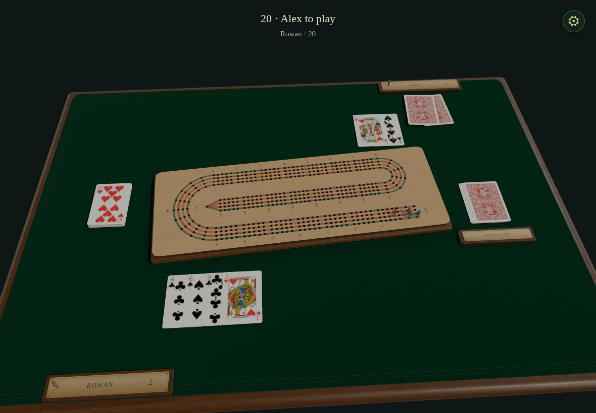

- [x] Exact phase, revision, round, count, crib size, clockwise seats, scores, private hands, public plays and legal native-card controls

## Rowan · plays Jack of hearts automatically · observer

Viewpoint: **Alex**

- [x] Exact phase, revision, round, count, crib size, clockwise seats, scores, private hands, public plays and legal native-card controls

## Alex plays Queen of clubs · actor

Viewpoint: **Alex**

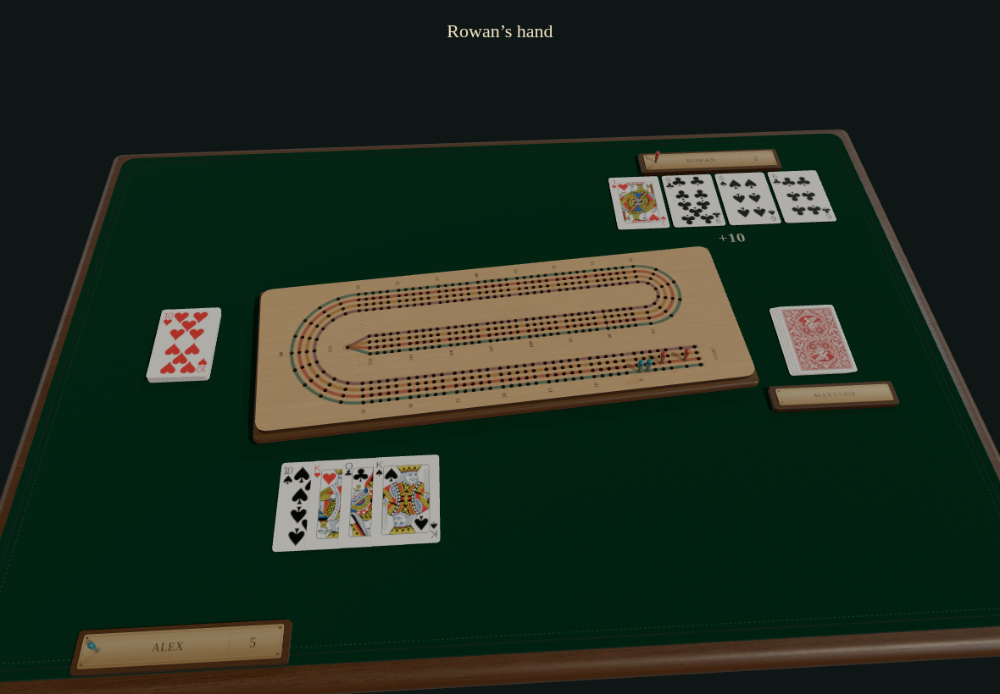

- [x] Exact phase, revision, round, count, crib size, clockwise seats, scores, private hands, public plays and legal native-card controls

## Alex plays Queen of clubs · observer

Viewpoint: **Rowan**

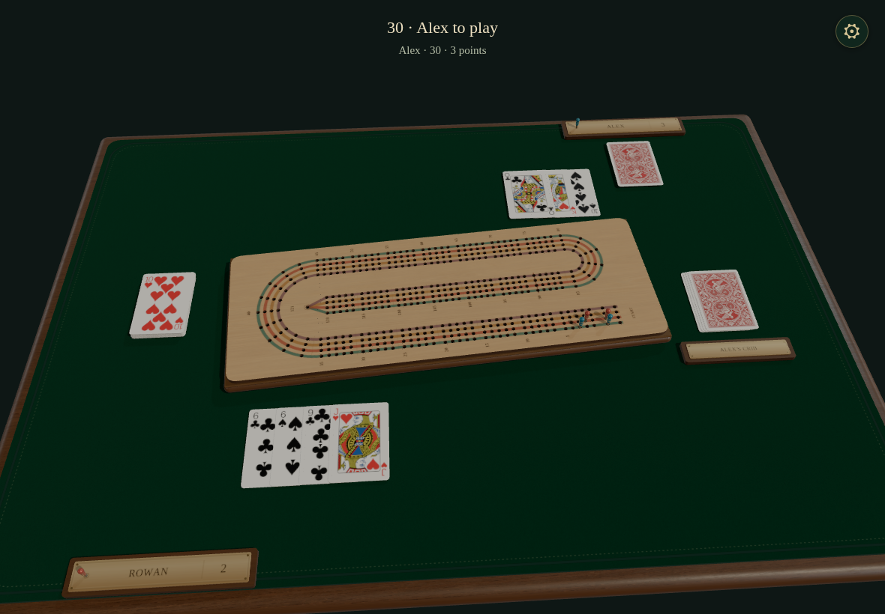

- [x] Exact phase, revision, round, count, crib size, clockwise seats, scores, private hands, public plays and legal native-card controls

## Alex · go automatically · actor

Viewpoint: **Alex**

- [x] Exact phase, revision, round, count, crib size, clockwise seats, scores, private hands, public plays and legal native-card controls

## Alex · go automatically · observer

Viewpoint: **Rowan**

- [x] Exact phase, revision, round, count, crib size, clockwise seats, scores, private hands, public plays and legal native-card controls

## Alex · plays King of spades automatically · actor

Viewpoint: **Alex**

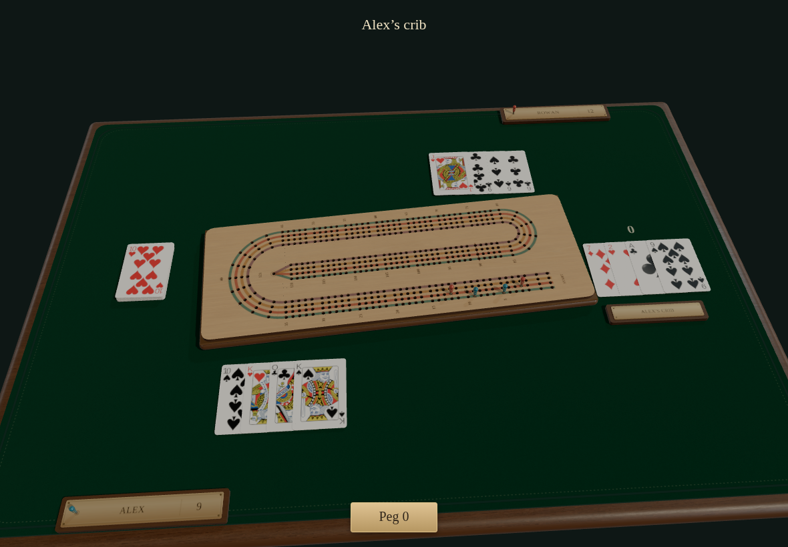

- [x] Exact phase, revision, round, count, crib size, clockwise seats, scores, private hands, public plays and legal native-card controls

## Alex · plays King of spades automatically · observer

Viewpoint: **Rowan**

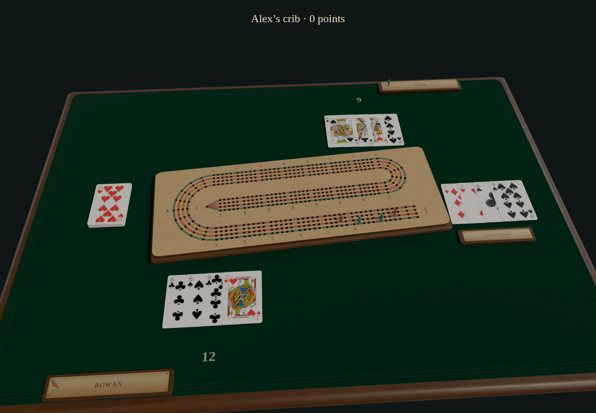

- [x] Exact phase, revision, round, count, crib size, clockwise seats, scores, private hands, public plays and legal native-card controls

## Rowan · pegs automatically · actor

Viewpoint: **Rowan**

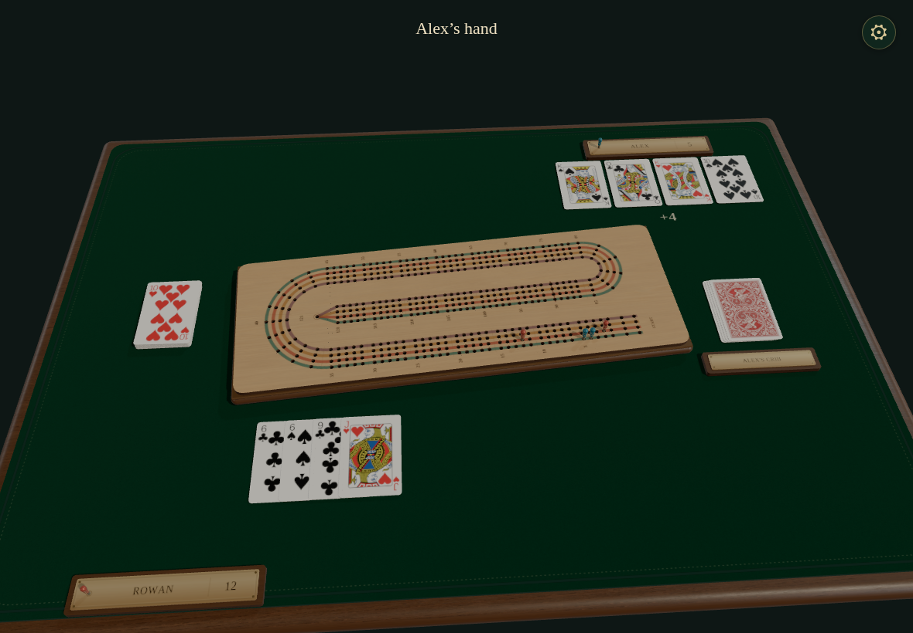

- [x] Exact phase, revision, round, count, crib size, clockwise seats, scores, private hands, public plays and legal native-card controls

## Rowan · pegs automatically · observer

Viewpoint: **Alex**

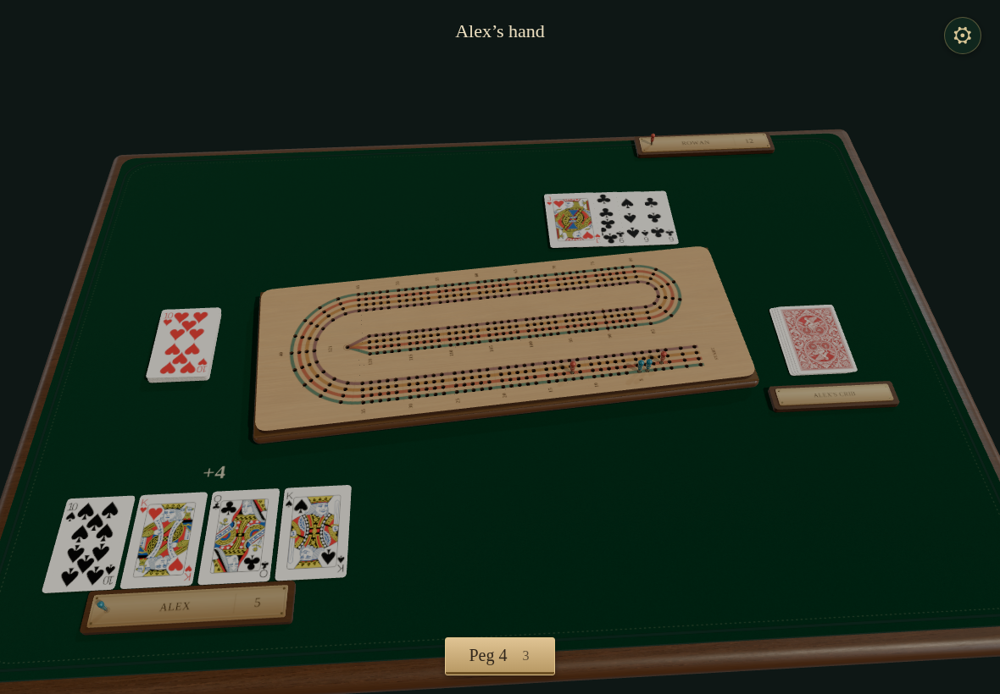

- [x] Exact phase, revision, round, count, crib size, clockwise seats, scores, private hands, public plays and legal native-card controls

## Alex · pegs automatically · actor

Viewpoint: **Alex**

- [x] Exact phase, revision, round, count, crib size, clockwise seats, scores, private hands, public plays and legal native-card controls

## Alex · pegs automatically · observer

Viewpoint: **Rowan**

- [x] Exact phase, revision, round, count, crib size, clockwise seats, scores, private hands, public plays and legal native-card controls

## Alex · pegs automatically · actor

Viewpoint: **Alex**

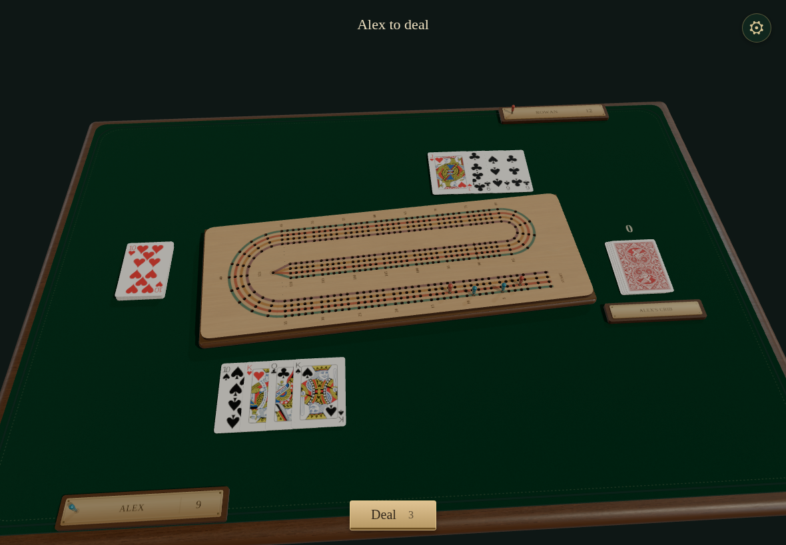

- [x] Exact phase, revision, round, count, crib size, clockwise seats, scores, private hands, public plays and legal native-card controls

## Alex · pegs automatically · observer

Viewpoint: **Rowan**

- [x] Exact phase, revision, round, count, crib size, clockwise seats, scores, private hands, public plays and legal native-card controls

## Alex · deal automatically · actor

Viewpoint: **Alex**

- [x] Exact phase, revision, round, count, crib size, clockwise seats, scores, private hands, public plays and legal native-card controls

## Alex · deal automatically · observer

Viewpoint: **Rowan**

- [x] Exact phase, revision, round, count, crib size, clockwise seats, scores, private hands, public plays and legal native-card controls

## Rowan returns to the same seat and hand · actor

Viewpoint: **Rowan**

- [x] Exact phase, revision, round, count, crib size, clockwise seats, scores, private hands, public plays and legal native-card controls

## Rowan returns to the same seat and hand · observer

Viewpoint: **Alex**

- [x] Exact phase, revision, round, count, crib size, clockwise seats, scores, private hands, public plays and legal native-card controls
