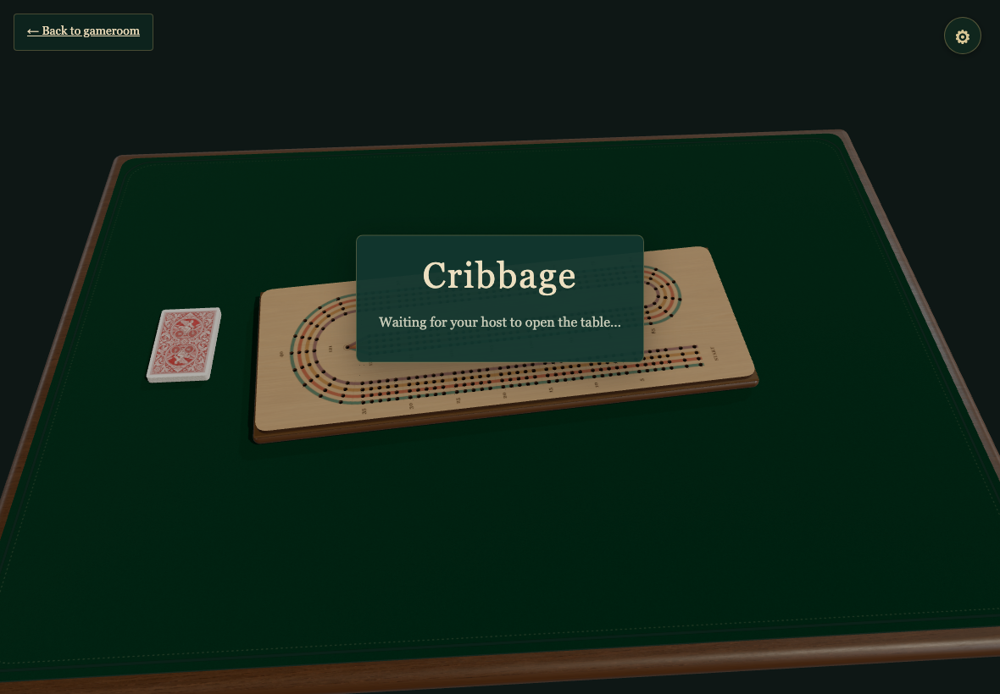
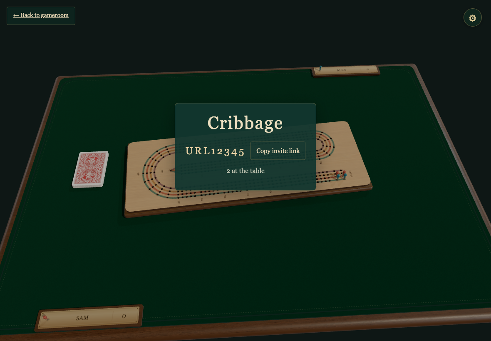
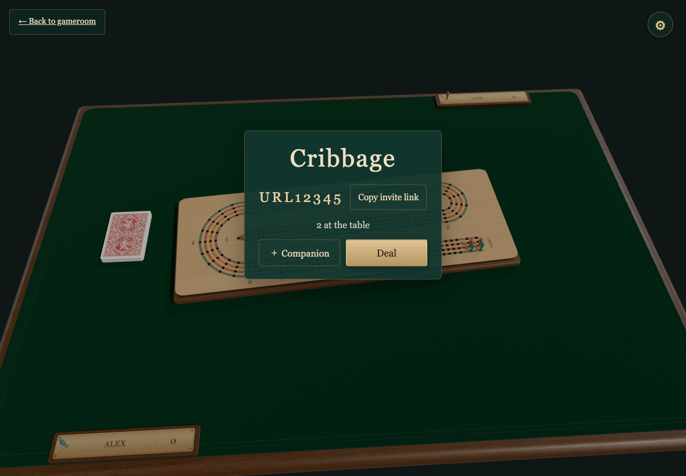

# URL invitations from a gathering room

Every user action is followed by the actor's view and all seated observers. All captures are 1180×820 at 1×; verification allows zero different pixels.

## A guest arriving first waits for the host

Viewpoint: **Sam**

- [x] The empty table is not claimed by its first visitor

## The host creates the table and both friends take a seat

Viewpoint: **Alex**

- [x] The URL supplies a name, the table has two players, and returning to gameroom is available

## The host creates the table and both friends take a seat

Viewpoint: **Sam**

- [x] The URL supplies a name, the table has two players, and returning to gameroom is available

## Reload retains the same two seats

Viewpoint: **Alex**

- [x] Neither create nor join is appended twice

## Reload retains the same two seats

Viewpoint: **Sam**

- [x] Neither create nor join is appended twice
